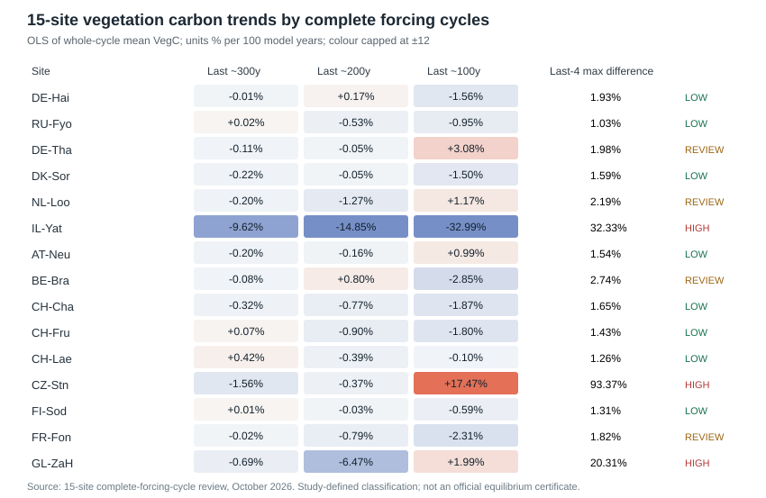
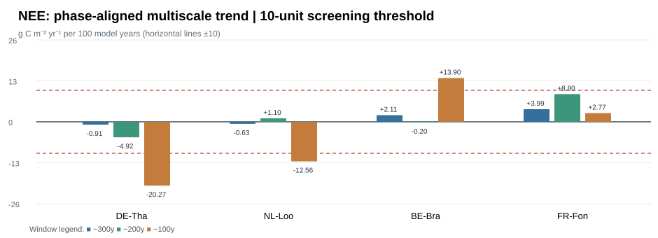
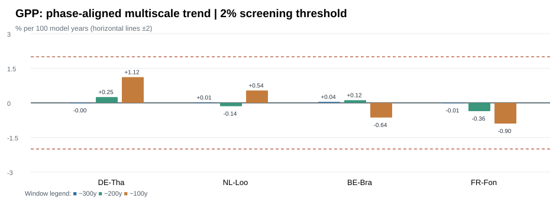

# Carbon and Flux Convergence Diagnostics

**15 CLM–FATES single-site case studies | 22 October 2026**

> **2026-10-22 PFT realism update:** Stage 0 now checks actual modeled FATES PFT identity against the EC site before deciding further spin-up. Four of six verified dynamic-competition cases have a broad-type mismatch (RU-Fyo, DE-Tha, NL-Loo, IL-Yat). The 22 October 2026 IRIDIS6 audit has now identified final dominant FATES PFTs for all 15 sites. Major mismatches include grassland sites simulated as broadleaf forest and CZ-Stn simulated as grassland. FR-Fon passes both the flux screen and broad PFT type check, while more detailed surface/footprint QC remains. See [PFT_REALISM_AND_FIXED_PFT.md](PFT_REALISM_AND_FIXED_PFT.md) and [15-site PFT table](data/15_site_pft_realism_screen.csv). **Do not blindly submit extensions based on the previous flux-only table; Stage 0 PFT realism gates decisions.**

This folder is the stand-alone, reproducible record of a two-stage **spin-up screening** workflow. It covers six sites from `FLUXNET_MultiSite_6` and nine completed sites from the original `FLUXNET_MultiSite_11` cohort. **Study-defined thresholds are operational decisions, not official CTSM/FATES equilibrium criteria.** This material is not a model–tower accuracy assessment.

## Screening logic

**Stage 1 — vegetation carbon:** from verified annual `FATES_VEGC`, partition all available model years into complete meteorological forcing cycles of length `L` starting at elapsed model year 1. Discard the unfinished tail `n % L`. For target `W ∈ {100,200,300}` years use `k = ceil(W/L)` whole cycles; fit OLS to the `k` cycle-mean VegC values at cycle-midpoint elapsed years. Normalize the fitted slope to `% per 100 model years`. Check the three non-overlapping ~100y blocks and the latest four pairs of *phase-matched* adjacent forcing cycles. Exploratory low-drift flag: **all three** absolute VegC trends <2%/100y **and all four** mean phase-matched absolute VegC differences <2% of the previous cycle's mean VegC. A 1% sensitivity screen is also recorded in the original analysis (0/15 pass; 2%: 8/15 pass).

**Stage 2 — NEE first, GPP second (only the four flagged borderline sites):** retrieve `FATES_NEP` and `FATES_GPP` from archived daily `h0a` output for >=300 elapsed model years of complete forcing cycles, integrate the daily rate using the noleap model day time bounds; `NEE = -FATES_NEP` so **negative NEE means net CO₂ uptake**. Cycle-mean annual NEE must be assessed in **g C m⁻² yr⁻¹**, not divided by its near-zero mean. **User-selected operational NEE criterion:** absolute slope < **10 g C m⁻² yr⁻¹ per 100 model years in EACH ~100/200/300y window**. GPP criterion: three absolute trend slopes < **2% per 100 model years** AND mean phase-matched absolute differences <**2%** for each of the last four adjacent forcing-cycle pairs. Do not interpret NEE's last-four-pair MAE (~20–28 g C m⁻² yr⁻¹) as a trend or apply the 10-unit trend threshold directly to MAE.

**Decision:** retain a borderline site if NEE+GPP pass the operational screens and its VegC review shows no compelling persistent growth; continue spin-up when the NEE screen fails, recording the failure window. Separately, three very-high-variability VegC sites were previously prioritized for continued spin-up without Stage 2 flux tests. Eight low-drift VegC sites **have not yet undergone Stage 2**, so their final flux readiness is pending. Actual CIME job submission is NOT recorded or implied here.

## Illustrated results

## Four borderline outcomes

| Site | NEE ~300y | NEE ~200y | NEE ~100y | GPP three-window and cycle test | Decision |
|---|---:|---:|---:|---|---|
| DE-Tha | −0.91 | −4.92 | **−20.27** | pass | **CONTINUE SPIN-UP** |
| NL-Loo | −0.63 | +1.10 | **−12.56** | pass | **CONTINUE SPIN-UP** |
| BE-Bra | +2.11 | −0.20 | **+13.90** | pass | **CONTINUE SPIN-UP** |
| FR-Fon | +3.99 | +8.80 | +2.77 | pass | **RETAIN** |

NEE values are slopes in `g C m⁻² yr⁻¹ per 100 model years`; the highlighted ~100-year slope determines each failed NEE screen. **FR-Fon has three NEE slopes with absolute magnitude below 10**, and its GPP trend is <2%/100y in all windows; last-four GPP phase differences also <2%. This is a *user-approved operational retention decision*, not proof of full soil-carbon equilibrium or tower realism.

## 15-site decisions

- **Retain after two-stage review (1):** FR-Fon.
- **Continue after two-stage review (3):** DE-Tha, NL-Loo, BE-Bra.
- **Continue after high VegC variability screen (3):** IL-Yat, CZ-Stn, GL-ZaH (NEE/GPP **not** independently tested here).
- **VegC low-drift candidates; flux test still pending (8):** DE-Hai, RU-Fyo, DK-Sor, AT-Neu, CH-Cha, CH-Fru, CH-Lae, FI-Sod.

The decisions do **not** mean that Slurm/CIME jobs have been submitted. In particular, DE-Tha/NL-Loo/IL-Yat had already been configured for 3000-year follow-up, so inspect active jobs and archived coordinated restart status instead of blindly resubmitting. For BE-Bra, decide the next complete-forcing-cycle checkpoint (e.g. 1300 cumulative model years) after safe CIME preflight. Previously proposed staged checkpoints: CZ-Stn 1305, GL-ZaH 1300; IL-Yat original 3000 target. Do not change PFT configuration or science inputs as part of a continuation.

## Files in this folder

- [Methods and evaluation rules](METHODS.md)
- [15-site VegC snapshot](data/15_site_phase_aligned_vegc_summary.csv)
- [4-site NEE/GPP test](data/4_site_flux_stationarity_summary.csv)
- [4-site extra VegC review](data/4_site_second_review_vegc_summary.csv)
- [All 15 decisions](data/15_site_decisions.csv)
- `cases/<site>/figures/`: two **actual previously published** site carbon-pool figures for each of the 15 sites; four sites additionally contain an **earlier model-versus-EC last-cycle** visualization, which is **not** evidence of multi-cycle NEE/GPP stability.
- `cases/<site>/data/`: original snapshot convergence metrics and metadata for all 15 sites; six sites also contain historical-snapshot annual VegC CSVs. Nine-site full annual CSVs and latest phase-aligned plots live in the IRIDIS6 Research Filestore and are **not yet duplicated in this initial GitHub commit**.

### Publish the remaining new source-derived figures and CSVs

Use [`scripts/07_publish_rfs_results.sh`](scripts/07_publish_rfs_results.sh) on **IRIDIS6 login nodes** to copy previously generated phase-aligned figures/CSVs for 15 sites, four borderline review figures/CSVs, and four NEE/GPP multi-cycle stationarity figures/CSVs into this folder on a **temporary fresh clone**. It validates presence and works without altering any CIME model case or your local conflicted main checkout. It requires the source RFS and Home result snapshots to remain intact and an authenticated GitHub remote. It does not rerun the model.

**Verified snapshot origins**

- 15-site phase-aligned VegC: `/research/xclimatetbm/ly3n24/CLM_FATES/Spinup_Analysis/vegc_convergence_15site/phase_aligned/20261021T235330Z_15site_FullCycle_VegC/`
- 4-site detailed VegC: `/research/xclimatetbm/ly3n24/CLM_FATES/Spinup_Analysis/vegc_convergence_15site/borderline_second_review/20261022T011032Z_four_site_review/`
- 4-site GPP/NEE: `/home/ly3n24/CLM_FATES_FluxStationarity/staging/20261022T012831Z_4site_NEE_then_GPP/`
- 6-site source annual snapshots: `/research/xclimatetbm/ly3n24/CLM_FATES/FLUXNET_MultiSite_6/convergence_snapshots/20261021T222202Z_archive_snapshot/`
- 9-site source annual snapshots: `/research/xclimatetbm/ly3n24/CLM_FATES/FLUXNET_MultiSite_11/spinup1000_final/`

## Caveats and scientific interpretation

- No universal peer-reviewed FATES rule mandates `VegC <2%` or `NEE trend <10`. These are **this project's provisional screening parameters**. Do not present screening flags as rigorously established equilibrium tests without sensitivity analysis.
- Some vegetation models show demographic fluctuations near a statistical steady state; by itself, a near-zero 300-year linear slope may hide compensating positive/negative trends. The sign of NEE drift is not the same as ecosystem carbon accumulation unless flux definitions and all relevant pools/fluxes are accounted for.
- `TOTECOSYSC` should not be assumed to include every live FATES vegetation pool. Avoid equating `TOTECOSYSC` and the actual full ecosystem carbon stock without checking the model's FATES diagnostics.
- The 4-site stationarity script checks **model temporal stability**, not agreement with EC observations; EC GPP NT/DT partitioning provenance is tracked separately in [issue #3](https://github.com/lyanyeung/CLM-FATES-single-site-workflows/issues/3).
- The earlier `GPP_NEE_monthly_overview.png` figures are a single latest complete model cycle mapped to tower years and **do not test NEE/GPP stationarity across successive spin-up cycles**.
- Earlier 15-site and 4-site summaries were reproduced from verified IRIDIS6 terminal output in the conversation; original phase-aligned time-series CSVs in RFS/Home should be copied using the publication helper below before stating that all raw derived evidence has been backed up on GitHub.

## Reproducible source scripts

- [01 — annual VegC baseline](../diagnostics/vegc_convergence_15sites/01_analyze_15site_vegc.py)
- [02 — 15-site phase-aligned VegC](../diagnostics/vegc_convergence_15sites/02_phase_aligned_15site_vegc.py)
- [04 — four borderline VegC review](../diagnostics/vegc_convergence_15sites/04_review_borderline_vegc.py)
- [05 — four-site NEE-first GPP stationarity](../diagnostics/vegc_convergence_15sites/05_neegpp_stationarity_four_borderline.py)
- [03 — high-variability guarded CIME continuation](../diagnostics/vegc_convergence_15sites/03_continue_high_variability_spinups.py)
