# FLUXNET six-site CLM-FATES workflow: surface, forcing, DATM and spin-up

**Current implementation (2026-10-11):** Six point surface datasets generated; QC v5 processed; 167/167 candidate annual DATM files validated; six independent 500-year CLM-FATES spin-ups submitted. Scientific QC, vegetation representation and measurement-height uncertainties remain under review.

**Record updated:** 2026-10-11. This is a reproducibility / decision log, not a statement that all site forcing has passed scientific quality assurance.

## Sites and annual forcing windows

| Site | Network package | Latitude | Longitude | Forcing years for a `NO_LEAP` spin-up | Half-hour records after removing 29 Feb |
|---|---|---:|---:|---|---:|
| DE-Hai | ICOS FLUXNET | 51.079213 | 10.452168 | 2000–2025 | 455,520 |
| RU-Fyo | EUF FLUXNET | 56.4615278 | 32.9220833 | 1998–2025 | 490,560 |
| DE-Tha | ICOS FLUXNET | 50.962597 | 13.565333 | 1996–2025 | 525,600 |
| DK-Sor | ICOS FLUXNET | 55.4858694 | 11.6446444 | 1996–2024 | 508,080 |
| NL-Loo | ICOS FLUXNET | 52.16644722 | 5.74355 | 1997–2025 | 508,080 |
| IL-Yat | EUF FLUXNET | 31.345044585655 | 35.0519885122776 | 2000–2024 | 438,000 |

The DE-Tha and NL-Loo releases have timestamps through the end of 2026 but their final 6,288 half-hours are missing across the meteorological variables in the October 2026 audit. **Exclude 2026 from the cycling window** rather than using future-year gap fills. Row completeness is not equivalent to observed-data completeness: FLUXNET `_F` variables can already contain network gap fills.

## Layout and numbered stages

```text
examples/FLUXNET_MultiSite_6/
├── README.md
├── scripts/
│   ├── 01_extract_6_fluxnet_nested.py         # copied from IRIDIS home before committing
│   ├── 02_make_6_surfaces.sh                 # copied from IRIDIS home before committing
│   ├── 03_prepare_six_site_forcing_v5.py
│   ├── 04_audit_six_site_qc_v5.py
│   ├── 05_inspect_two_site_humidity.py
│   ├── 06_check_surface_zbot_make_datm.py
│   ├── 07_make_six_site_datm_timevarying_zbot.py
│   ├── 08_audit_six_site_datm_surface.py
│   ├── 09_submit_six_site_spinup500.sh
│   └── history/                            # earlier experimental QC versions v1–v4
└── .gitignore
```

### 01 — Raw package extraction

Unpack the six network downloads. Some outer ZIPs contain another ZIP, so extraction must recurse. The script is the **actual script used on IRIDIS**, copied from `~/extract_6_fluxnet_nested.py`. It checks that BIF metadata and half-hour FLUXMET files can be found after extraction. Source packages are not included in Git.

### 02 — Point surface generation

The actual six-site script, copied from `~/make_6_surfaces.sh`, reads BIF coordinates and runs CTSM `tools/site_and_regional/subset_data point` to construct site-specific surface datasets and user mods. All six sites printed `SURFACE COMPLETED` in the October 2026 execution. The `No dominant pft type is chosen` warning did **not** prevent generation, but land cover / PFT fractions have **not yet been validated** against station vegetation. Creation success does not establish ecological suitability. Static surface data do not depend on meteorological QC and do not need regenerating merely because forcing QA is updated.

### 03 — Meteorological forcing QC, experimental version 5

Use `03_prepare_six_site_forcing_v5.py` with FLUXNET `FLUXMET_HH` (`TA_F`, `VPD_F`, `PA_F`, `SW_IN_F`, `LW_IN_F`, `WS_F`, `P_F`) and the package's **`ERA5_HH` companion**. These are not independently downloaded ERA5-Land files. Retain reasonable consolidated `*_F` values, including network gap-filled data, and use `*_F_QC` to preserve reported data provenance. Apply targeted physical screens, very short interpolations when suitable, and ERA-based reconstruction when indicated. Retain replacement event and manual review logs. **A QC code of 0 does not guarantee a physical validity check will pass.**

Scripts contain site-specific IRIDIS absolute paths and were not made machine-independent. Review their settings and dependencies before reuse elsewhere. The experimental thresholds (including RH-based VPD reconstruction) are research decisions, not official FLUXNET QC rules. The resulting `processed_v5` values are **candidate forcing**, not yet approved for final spin-up.

Suggested IRIDIS execution from a clone (assuming the packages and CTSM input data already exist at configured paths):

```bash
python scripts/01_extract_6_fluxnet_nested.py
bash scripts/02_make_6_surfaces.sh
python scripts/03_prepare_six_site_forcing_v5.py --sites DE-Hai RU-Fyo DE-Tha DK-Sor NL-Loo IL-Yat
python scripts/04_audit_six_site_qc_v5.py
```

The original scripts were executed from IRIDIS home (`~/...`). Most stage-01/02 operations need **not** be repeated if inputs have already been generated.

## QC history: why versions v1–v5 exist

| Revision | Main issue / change | Interpretation |
|---|---|---|
| v1 | Physically inconsistent TA–VPD pairs could trigger joint TA and VPD substitution. | Overly aggressive for valid measured TA; NL-Loo had 3,748 site-variable modifications. |
| v2 | Prefer keeping TA and adjusting VPD; IL-Yat 10 ERA humidity pairs were diagnosed. | Improved preservation of measured TA but missed demonstrably bad zero-temperature stretches. |
| v3 | Detect warm-season `TA=0°C` artifacts and winter `TA≈0°C`, `VPD≈6.110 hPa` plateaus. | Incorrectly also replaced plausible winter TA at 311 NL-Loo half-hours. |
| v4 | Keep plausible winter TA; fix plateau VPD only, with explicit review tags. | NL-Loo TA modifications reduced to 15; 355 remaining very-low-RH cases identified. |
| v5 | Additional screening of near-zero actual vapour pressure with contrasting ERA humidity, preserving tower TA. | 367 NL-Loo and 14 IL-Yat candidate low-RH adjustments; all marked for scientific review. |

For cross-version comparisons, prefer site-variable modification events and unique half-hour timestamps over blindly comparing totals of different review categories. The archived versions document the development history, **not** alternative validated reference products.

## Six-site v5 audit snapshot (2026-10-11)

| Site | v5 status | Site-variable changes | Changed official `QC=0` records | Review rows | Remaining `RH<1%` | Remaining `TA≈0 & VPD≈6.110` |
|---|---|---:|---:|---:|---:|---:|
| DE-Hai | REVIEW | 23 | 0 | 24 | 0 | 0 |
| RU-Fyo | REVIEW | 21 | 13 | 127 | 0 | 0 |
| DE-Tha | REVIEW | 32 | 1 | 14 | 0 | 0 |
| DK-Sor | PASS | 4 | 0 | 0 | 0 | 0 |
| NL-Loo | REVIEW | 1,734 | 1,129 | 845 | 160 | 99 |
| IL-Yat | REVIEW | 991 | 4 | 154 | 69 | 0 |

**Total:** 2,925,840 half-hour records across six site-specific windows; 2,805 site-variable modification events. These counts come from the actual IRIDIS v5 output and `audit_six_site_qc_v5.py`. An event count is not a count of unique times or physical error events.

### Outstanding scientific review — MUST NOT silently discard

- **NL-Loo (highest priority):** 1,112 VPD and 13 TA changes affected official `QC=0` measurements (plus four LW changes). A further 160 times have computed RH below 1%, with 99 remaining `TA≈0 & VPD≈6.110` pairings; 89 of those had ERA RH at least 50% in the audit. Some 2022 warm-zero-temperature instances have been repaired using ERA. Confirm zero-plateau meaning and RH reconstruction against station metadata / original humidity observations; avoid automatically accepting all ERA substitutions.
- **RU-Fyo:** 127 `outside_review_range_kept_not_replaced` entries (likely radiation-focused, but exact variables/values require inspection); 13 modified official `QC=0` LW records. Determine whether these are real cold-region extremes or sensor/product errors.
- **IL-Yat:** 154 review rows (149 distinct half-hours); 69 very-low-RH residual records. Some 2011-04-18 ERA-sourced TA/VPD pairs yielded RH below zero; eight records were provisionally adjusted using an **assumed** 1% RH lower bound. The 2013-03-26 observed TA versus ERA-derived VPD mismatch is especially sensitive to humidity reconstruction. Desert/semi-arid extreme dryness should not be erased solely for differing from ERA.
- **DE-Tha:** 11 `outside_review_range_kept_not_replaced` entries and three reconstructed VPD review entries; one altered official `QC=0` LW value.
- **DE-Hai:** 23 reconstructed VPD review entries plus one retained out-of-review-range record.
- **DK-Sor:** automatic screening returned PASS, but site PFT and sensor height still require independent verification.

**Review policy:** ERA divergence alone does **not** prove tower measurements are wrong, particularly for heatwaves, drought, extreme precipitation, and radiation conditions. Where ambiguity remains, retain the item in `REVIEW`, record a justified choice, or conduct sensitivity tests; do not force an all-PASS label. `PASS` is an automated screen result, not complete scientific validation.

### Outputs not committed to Git

On IRIDIS, for each site under `/iridisfs/scratch/ly3n24/CLM_FATES/sites/MY_EC_SITE/<SITE>/forcing/`:

- `raw/` — original extracted flux/ERA files, never overwritten.
- `processed_v5/` — candidate forcing CSV.
- `qc_v5/` — replacement event logs, manual review files, summaries, and diagnostic tables.
- `subset_data/` — CTSM surface NetCDF and user modifications (at the **site root**, not inside `forcing/`).

The exact processed output file name should be read from the v5 script, not guessed. Do not add original FLUXNET packages, downloads, tokens, large CSVs, `.nc`, case `run/`, or archive files to this GitHub example. Network/source data redistribution conditions must be respected.

## Original stage-03 follow-up plan (historical; see implementation update below)

1. Resolve or explicitly document high-impact QC review events (especially official QC=0 replacements and longwave outliers); archive versioned QC reports outside Git.
2. Verify the extracted surface PFT coverage against real site vegetation; obtain appropriate reference vegetation and soil information as needed.
3. Extract and verify per-site forcing/reference measurement height (`ZBOT`) from station metadata; distinguish measurement height from canopy height.
4. Build and validate annual CLM-FATES DATM NetCDFs with 17,520 records per `NO_LEAP` year and eight required variables: `TBOT`, `QBOT`, `PSRF`, `FSDS`, `FLDS`, `WIND`, `PRECTmms`, `ZBOT`.
5. Set up **independent** 500-year startup spin-ups using each site's *entire eligible forcing-year window* as `DATM taxmode=cycle`; separately configure a fixed atmospheric CO2 concentration associated with the site's first forcing year (verify concentrations and citation before using them).
6. Evaluate spin-up convergence using carbon pool trends and restarts; a successful job does not by itself demonstrate equilibrium or convergence.

## Related single-site examples

- [`../FLUXNET_GF-Guy/`](../FLUXNET_GF-Guy/) — GF-Guy surface/case/spin-up example.
- [`../ICOS_ES-LJu/`](../ICOS_ES-LJu/) — ES-LJu forcing QC and CLM-FATES workflow.


## Implementation update: dynamic ZBOT, DATM and 500-year spin-up

### Stage 02 — Surface data

All six surface datasets were generated using
`scripts/02_make_6_surfaces.sh` and the CTSM point-subsetting utility,
with surface reference year 2000.

The generated gridded surface landunits are not necessarily
representative of the actual flux-tower footprint. In particular,
PCT_CROP ranges from 3.3% (RU-Fyo) to 44.6% (DK-Sor).
FATES vegetation initialization and the natural-landunit treatment
require further scientific verification. The surfaces were not
regenerated when sensor heights were subsequently processed.

### Stages 04–05 — Measurement heights and DATM

`scripts/06_check_surface_zbot_make_datm.py` records the initial
constant-height DATM candidate workflow and metadata checks.

`scripts/07_make_six_site_datm_timevarying_zbot.py` is the later
time-dependent-ZBOT implementation actually used to generate
the final candidate DATM files. It uses dated BIF TA_F sensor
heights, including changes within the historical forcing period.

| Site | ZBOT history (m) | Forcing period | Annual DATM files |
|---|---|---|---:|
| DE-Hai | 44 -> 44.5 (2023-06-06) | 2000–2025 | 26 |
| RU-Fyo | 28 | 1998–2025 | 28 |
| DE-Tha | 40 | 1996–2025 | 30 |
| DK-Sor | 57 -> 30 (2014-04-11) -> 43 (2021-02-06) | 1996–2024 | 29 |
| NL-Loo | 23.5 -> 38.2 (2023-05-23) | 1997–2025 | 29 |
| IL-Yat | 15 -> 19 (2012-01-01) | 2000–2024 | 25 |

Total: **167 annual NetCDFs**, each containing 17,520 half-hour
records on a NO_LEAP calendar.

The dynamic ZBOT files are under each site's
`forcing/datm_v5_candidate_timevarying_zbot/` directory on IRIDIS.

Important limitations:

- Some first-year height values are extrapolated backwards from
  the first available BIF sensor-height date.
- DK-Sor, NL-Loo and IL-Yat have substantial periods with
  mismatched TA and WS measurement heights.
- Wind speed was not vertically adjusted to the TA height.
- The forcing is QC v5 candidate data, not fully approved observations.

### Stage 06 — Final structural audit

`scripts/08_audit_six_site_datm_surface.py` was run on IRIDIS.
Result: **167/167 annual DATM files passed structural validation**.

All six sites returned `STRUCTURE_OK_REVIEW`.
This establishes file compatibility and basic numerical checks,
not final scientific validity. QC v5 manual reviews remain unresolved
at five sites, and surface landunit/PFT representation requires review.

### Stage 07 — Independent 500-year spin-ups

`scripts/09_submit_six_site_spinup500.sh` is the corrected,
successfully executed six-site submission script.

The case setup is based on the existing GF-Guy FATES workflow,
reusing its compiled executable through CIME cloning while
applying each site's own surface, forcing and fixed CO2 setting.

| Site | Meteorological cycling years | Fixed CO2 (ppm) |
|---|---|---:|
| DE-Hai | 2000–2025 | 368.96 |
| RU-Fyo | 1998–2025 | 365.70 |
| DE-Tha | 1996–2025 | 361.93 |
| DK-Sor | 1996–2024 | 361.93 |
| NL-Loo | 1997–2025 | 363.04 |
| IL-Yat | 2000–2024 | 368.96 |

Fixed atmospheric CO2 values correspond approximately to global
annual mean concentrations in each site's initial forcing year;
they are not local EC-tower measurements.

Spin-up configuration:

- RUN_TYPE = startup
- CALENDAR = NO_LEAP
- ATM_NCPL = 48
- CLM_CO2_TYPE = constant
- DATM taxmode = cycle, using the site's entire available forcing window
- STOP_OPTION = nyears; STOP_N = 5
- REST_OPTION = nyears; REST_N = 5
- RESUBMIT = 99
- Intended total: 100 segments x 5 years = 500 model years per site

**The five-year job segment length is not the meteorological
cycling period.** Meteorological years cycle according to each
site's historical forcing window, across successive restart jobs.

All six independent initial jobs were successfully submitted
to IRIDIS6 on 2026-10-11. This does not certify completion of
the 500-year simulations or convergence of vegetation/carbon pools.

**Do not rerun the submission script against active cases.**
This repository records the configuration and source code;
it does not contain raw FLUXNET packages, surface NetCDFs,
DATM NetCDFs, CIME case outputs, or model history/restart files.

## Stage 08 — GPP and NEE comparison during spin-up

Script: `scripts/10_compare_six_site_latest_complete_cycle.py`

This script compares CLM-FATES GPP and NEE with FLUXNET eddy
covariance observations for all six sites.

Key features:

- Automatically identifies the latest complete meteorological
  forcing cycle from archived annual `h0a` files.
- Maps simulated years back to each site's original EC years.
- Uses `FATES_GPP` for simulated GPP and `-FATES_NEP` for NEE.
- Uses FLUXNET GPP_DT_VUT_REF and NEE_VUT_REF observations.
- Produces daily and monthly comparison CSV files.
- Calculates R, R2, RMSE, MAE and Bias.
- Creates monthly GPP and NEE plots using the same plotting
  conventions as the ICOS_ES-LJu example.
- Supports both Jan-01 and Jan-02 annual h0a filename timestamps.
- Reads archived history without modifying running simulations.

The output represents an interim spin-up diagnostic, not necessarily
a converged 500-year equilibrium result.

Run on IRIDIS:

    python scripts/10_compare_six_site_latest_complete_cycle.py

Figures and metrics are saved under each site's
`validation/spinup_latest_complete_cycle/` directory.

The figures and model NetCDF output files are not committed to GitHub.

<!-- SIX_SITE_OVERVIEW_START -->

## Example results: Six-site GPP and NEE comparison

Monthly CLM-FATES GPP and NEE compared with FLUXNET eddy covariance observations.

Each figure shows the latest complete meteorological forcing cycle available during the 500-year spin-up, mapped onto the original observation years.

**Note:** These are interim spin-up diagnostics, not final converged simulations. Model forcing, vegetation representation and convergence require further scientific evaluation.

### DE-Hai

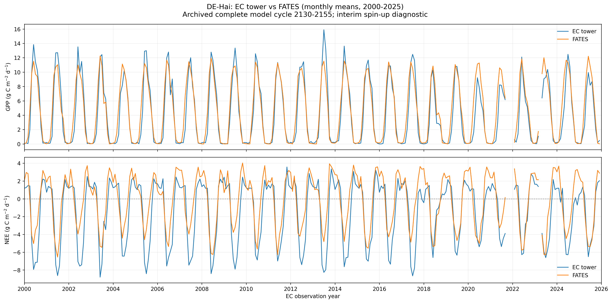

Monthly performance: **GPP R² = 0.883**; **NEE R² = 0.631**.

### RU-Fyo

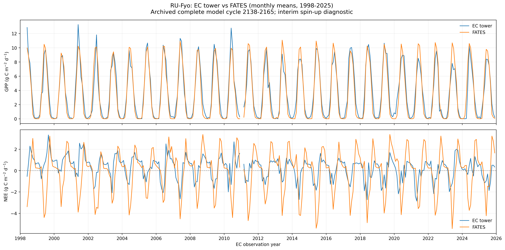

Monthly performance: **GPP R² = 0.917**; **NEE R² = -1.619**.

### DE-Tha

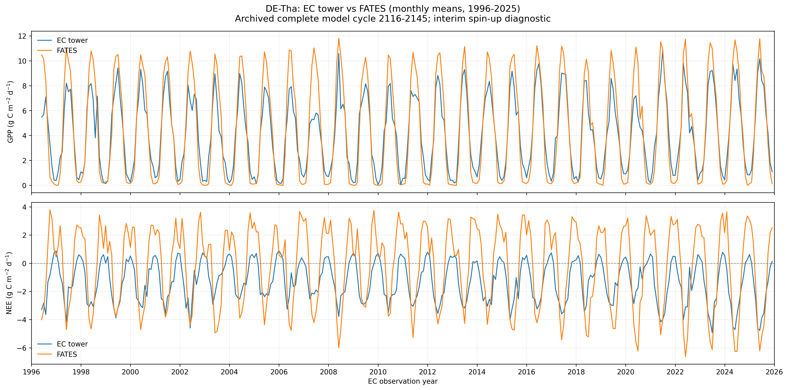

Monthly performance: **GPP R² = 0.725**; **NEE R² = -1.179**.

### DK-Sor

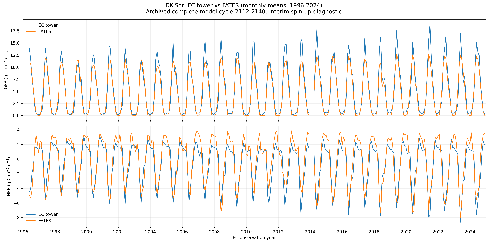

Monthly performance: **GPP R² = 0.913**; **NEE R² = 0.810**.

### NL-Loo


Monthly performance: **GPP R² = -0.030**; **NEE R² = -1.674**.

### IL-Yat

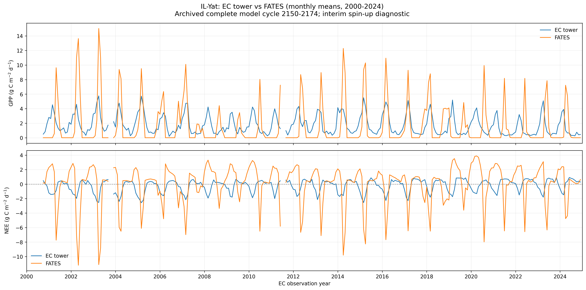

Monthly performance: **GPP R² = -3.146**; **NEE R² = -9.479**.

<!-- SIX_SITE_OVERVIEW_END -->

<!-- SPINUP500_FINAL_START -->

## Final 500-year spin-up results

All six CLM-FATES simulations completed 500 model years.
Each simulation cycles its own full meteorological forcing period
and uses fixed atmospheric CO2 from its initial forcing year.

The following figures show annual carbon-pool trajectories
and monthly GPP/NEE comparisons against FLUXNET EC observations
for the last complete meteorological forcing cycle.

**Important:** Completing 500 years does not demonstrate
carbon-pool or FATES demographic convergence.
Several slow carbon pools continue to drift.

| Site | Monthly GPP R² | Monthly NEE R² |
|---|---:|---:|
| DE-Hai | 0.878 | 0.616 |
| RU-Fyo | 0.917 | -1.525 |
| DE-Tha | 0.719 | -1.367 |
| DK-Sor | 0.913 | 0.800 |
| NL-Loo | -0.059 | -1.721 |
| IL-Yat | -2.571 | -8.012 |

### DE-Hai

**500-year carbon-pool trajectories**

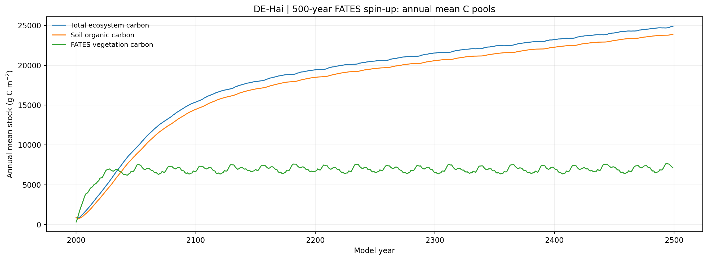

**Final complete meteorological cycle: GPP and NEE**

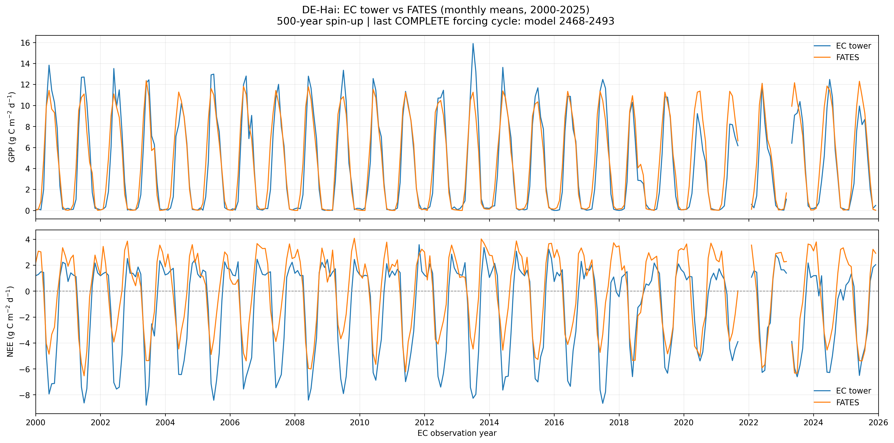

Monthly GPP R² = 0.878; monthly NEE R² = 0.616.

---

### RU-Fyo

**500-year carbon-pool trajectories**

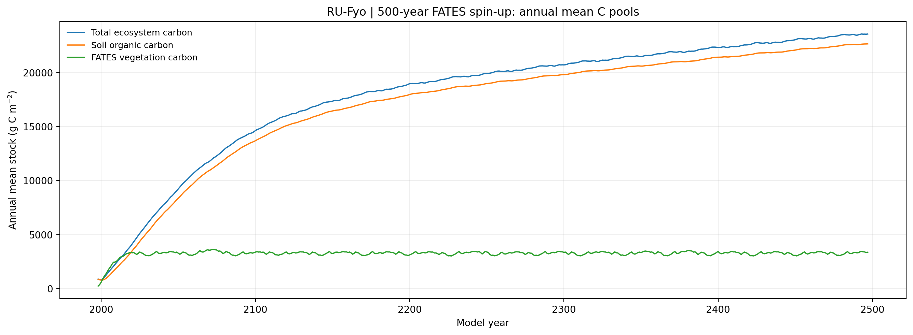

**Final complete meteorological cycle: GPP and NEE**

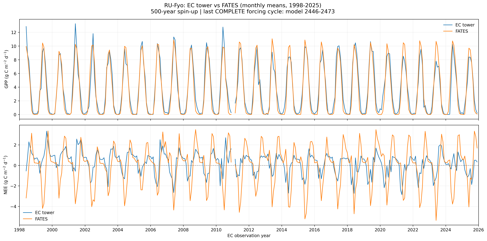

Monthly GPP R² = 0.917; monthly NEE R² = -1.525.

---

### DE-Tha

**500-year carbon-pool trajectories**

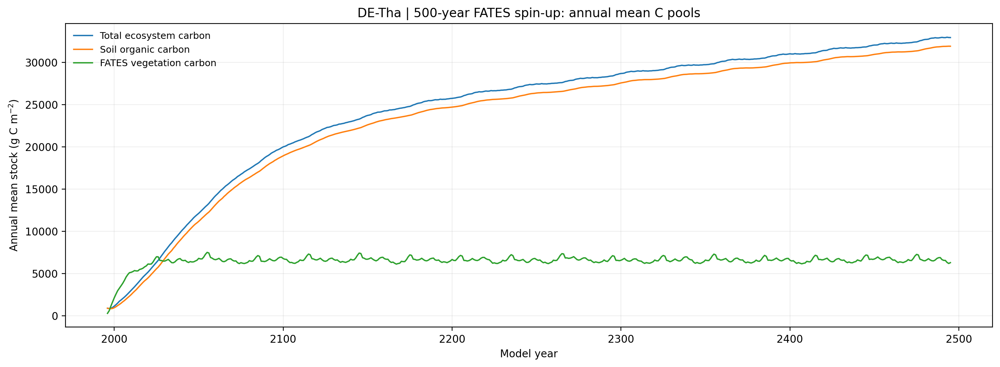

**Final complete meteorological cycle: GPP and NEE**

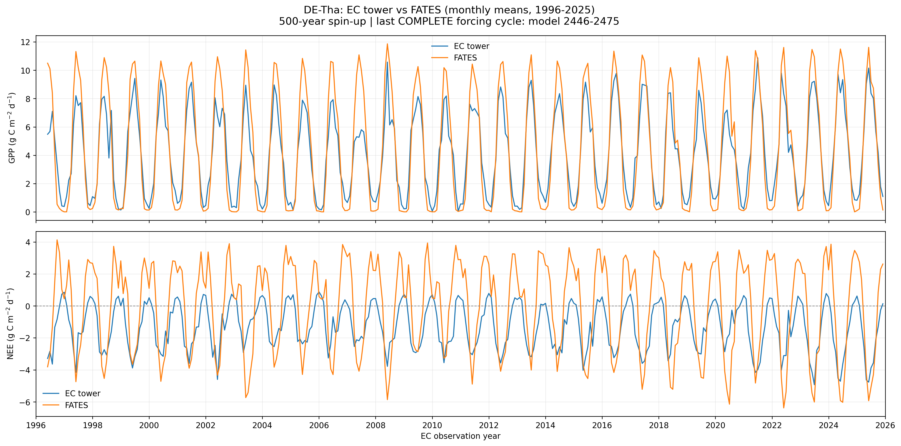

Monthly GPP R² = 0.719; monthly NEE R² = -1.367.

---

### DK-Sor

**500-year carbon-pool trajectories**

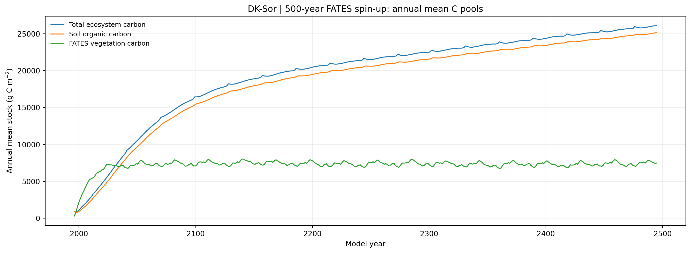

**Final complete meteorological cycle: GPP and NEE**

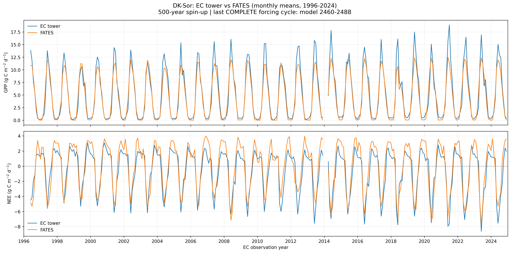

Monthly GPP R² = 0.913; monthly NEE R² = 0.800.

---

### NL-Loo

**500-year carbon-pool trajectories**

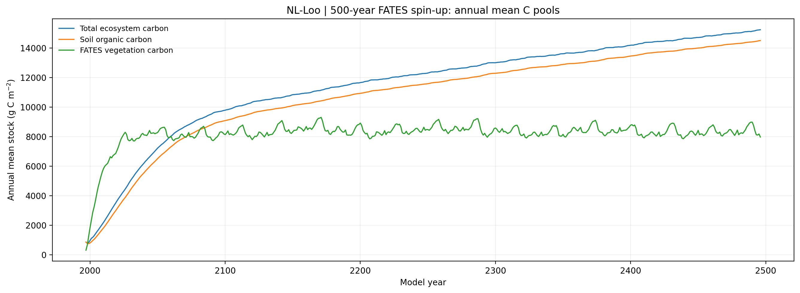

**Final complete meteorological cycle: GPP and NEE**

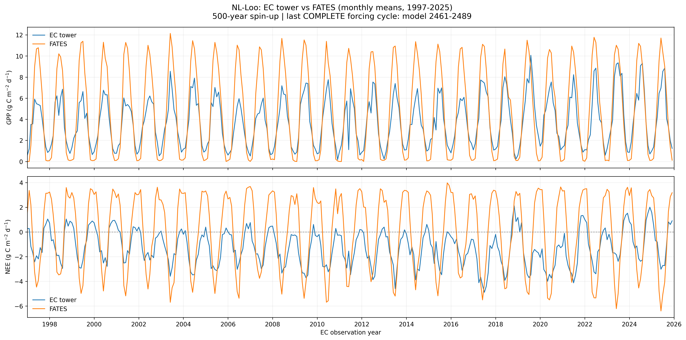

Monthly GPP R² = -0.059; monthly NEE R² = -1.721.

---

### IL-Yat

**500-year carbon-pool trajectories**

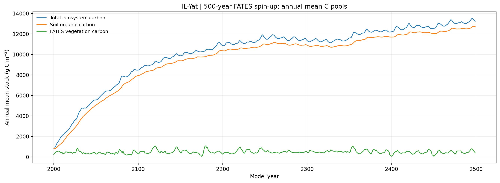

**Final complete meteorological cycle: GPP and NEE**

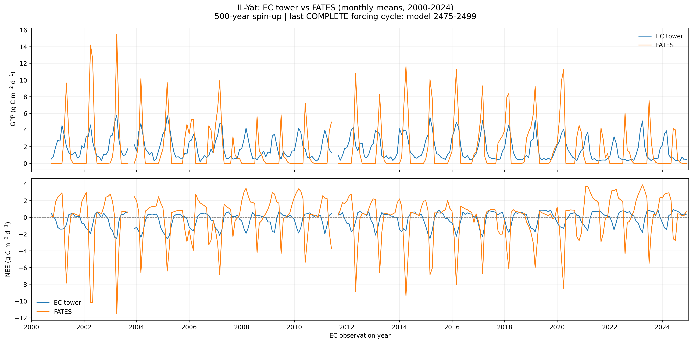

Monthly GPP R² = -2.571; monthly NEE R² = -8.012.

---

The earlier interim-spin-up figures are retained above
for comparison. These final-cycle results are model diagnostics
and still require scientific review of convergence, forcing QC,
and site vegetation representation.

<!-- SPINUP500_FINAL_END -->

<!-- SIX_SITE_SPINUP1000_START -->

## Stage 09 — Extending the six completed 500-year spin-ups to 1000 model years (2026-10-14)

All six original CLM-FATES spin-ups completed 500 model years, but some slow carbon pools still showed drift. This continuation starts from each site's **fully archived 500-year coordinated restart**, adds **500 more model years** in 100 five-year segments, and targets **1000 model years total**. Running for 1000 years is not proof of carbon-pool or FATES demographic convergence.

- [Continuation script (`13_extend_six_site_spinup500_to1000.sh`)](scripts/13_extend_six_site_spinup500_to1000.sh)
- [Detailed operating guide, checkpoints and safeguards](docs/spinup500_to1000_continuation_2026-10-14.md)
- [Repository-wide IRIDIS6 MPI and CPU-affinity investigation](../../IRIDIS6_MPI_CPU_AFFINITY.md)
- [Original 500-year spin-up submission script — historical only](scripts/09_submit_six_site_spinup500.sh)

| Site | Completed 500-year restart | Target 1000-year restart | Constant CO2 (ppm) |
|---|---|---|---:|
| DE-Hai | 2500-01-01 | 3000-01-01 | 368.96 |
| RU-Fyo | 2498-01-01 | 2998-01-01 | 365.70 |
| DE-Tha | 2496-01-01 | 2996-01-01 | 361.93 |
| DK-Sor | 2496-01-01 | 2996-01-01 | 361.93 |
| NL-Loo | 2497-01-01 | 2997-01-01 | 363.04 |
| IL-Yat | 2500-01-01 | 3000-01-01 | 368.96 |

### IRIDIS6 MPI/Slurm affinity: why the launcher matters

In the related eight-site study, an inherited OpenMPI launcher (`mpirun -n 1 --bind-to core --map-by socket`) was observed assigning a launched process to Linux CPU 0 even when independent Slurm jobs were allocated **different** CPU IDs. Eight concurrently launched models then slowed markedly and timed out. These affinity tests establish a mismatch in the tested environment; they do not prove every historical model rank was on CPU 0. The successful single-rank replacement is:

```bash
srun --mpi=pmix --ntasks=1 --cpus-per-task=1 --cpu-bind=cores
```

The continuation script requests 1 CPU and 8 GiB per case, without `--exclusive`, and preserves the original site-specific forcing cycles, surfaces, CO2, numerical configuration, executable, and five-year restart cadence. **Slurm CPU allocation is not the same thing as the actual CPU affinity of `cesm.exe`**. Compare `scontrol show job -dd JOBID` (Slurm `CPU_IDs`) against the model process's `/proc/PID/status` (`Cpus_allowed_list`) on the compute node.

An optional `EXCLUDE_NODES=red6129` excludes one specific node from the six-site launch but **does not guarantee permanent node separation** from the independent eight-site chain, which may migrate to other nodes. CPU core-binding correctness is the primary requirement.

### Safe execution and current status

The script's `audit` mode checks the six **idle**, fully archived 500-year cases; `prepare` makes backups, stages coordinated restarts, corrects the MPI launcher and configures the 100 additional five-year segments **without submission**; `submit SESSION` submits once; `status` reports read-only progress.

The six-site continuation **was already submitted** on 2026-10-14 (first run jobs: DE-Hai 4237364, RU-Fyo 4237366, DE-Tha 4237368, DK-Sor 4237370, NL-Loo 4237372, IL-Yat 4237374). At the latest available queue snapshot they were running or pending, **not verified as complete**. Do **not** repeat `prepare`, `submit` or the historical original spin-up script on active cases.

For current monitoring on IRIDIS6:

```bash
bash ~/13_extend_six_site_spinup500_to1000.sh status
squeue -u ly3n24 -o '%.12i %.36j %.10T %.12M %.12l %R'
```

Only after the extra 500 years are successfully archived should convergence be re-evaluated using carbon pool trends (including `TOTECOSYSC`, live vegetation and slower soil pools), not GPP/NEE agreement alone. The public GitHub repository does not contain restricted EC downloads, NetCDF data, restarts, or model archives.

<!-- SIX_SITE_SPINUP1000_END -->

<!-- SPINUP1000_FINAL_RESULTS_START -->

## Five-site 1000-year spin-up results (18 October 2026)

Five sites successfully archived **1000 continuous annual h0a files**
and completed read-only carbon and flux diagnostics. **DE-Hai is
excluded** from this release. These are diagnostics, not evidence
that any site has reached carbon-pool or demographic equilibrium.

All model cases retain the original \`<SITE>_FATES_SPINUP500\` name
despite continuing from 500 to 1000 elapsed model years.

| Site | Latest complete model forcing cycle | Monthly GPP R² | Monthly NEE R² |
|---|---|---:|---:|
| RU-Fyo | 2950–2977 | 0.918 | -1.508 |
| DE-Tha | 2956–2985 | 0.729 | -1.365 |
| DK-Sor | 2953–2981 | 0.910 | 0.794 |
| NL-Loo | 2954–2982 | -0.023 | -1.710 |
| IL-Yat | 2975–2999 | -2.451 | -7.466 |

GPP and NEE comparisons use the last **complete, phase-aligned** forcing
cycle mapped back onto the original EC observation years; they do
not necessarily cover the simulation's final 100 model years.

Convergence CSVs report last-30/100-year trends, paired forcing-cycle
changes, and phase-aligned 500-vs-1000-year cycle means. These
metrics are not automatic convergence pass/fail thresholds.

[Five-site numerical summary](figures/spinup1000_final/five_site_spinup1000_summary.csv)
 · [Reproducible Python analysis](scripts/14_plot_five_site_spinup1000.py)
 · [IRIDIS6 Slurm job](scripts/15_submit_five_site_spinup1000_plots.sh)
 · [Result publishing script](scripts/16_publish_five_site_spinup1000.py)

### RU-Fyo — 1000 years

**Carbon pools, years 1–1000**

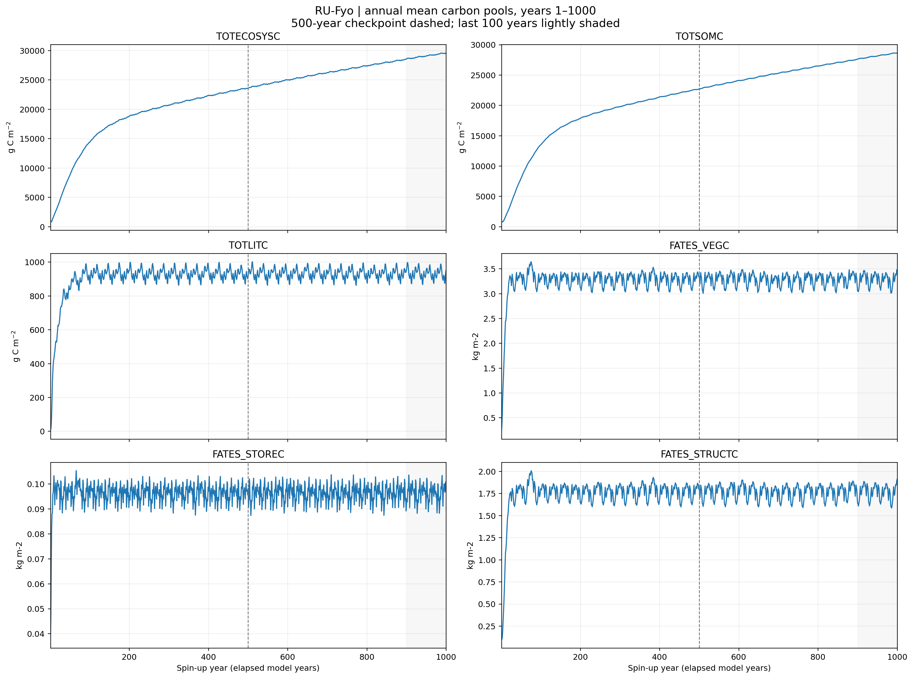

**Carbon pools, last 250 years**

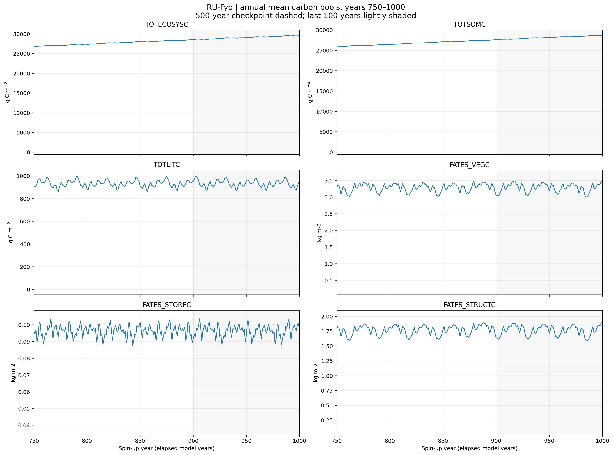

**Latest complete forcing-cycle GPP/NEE versus EC**

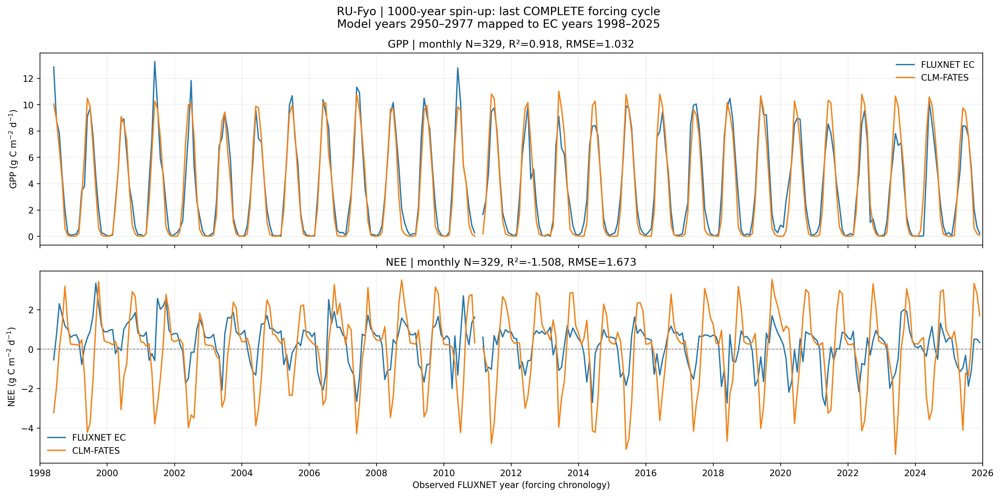

[Carbon annual means](figures/spinup1000_final/RU-Fyo/RU-Fyo_carbon_annual_means.csv) · [Convergence statistics](figures/spinup1000_final/RU-Fyo/RU-Fyo_convergence_metrics.csv) · [Monthly GPP/NEE skill statistics](figures/spinup1000_final/RU-Fyo/RU-Fyo_monthly_metrics.csv)

### DE-Tha — 1000 years

**Carbon pools, years 1–1000**

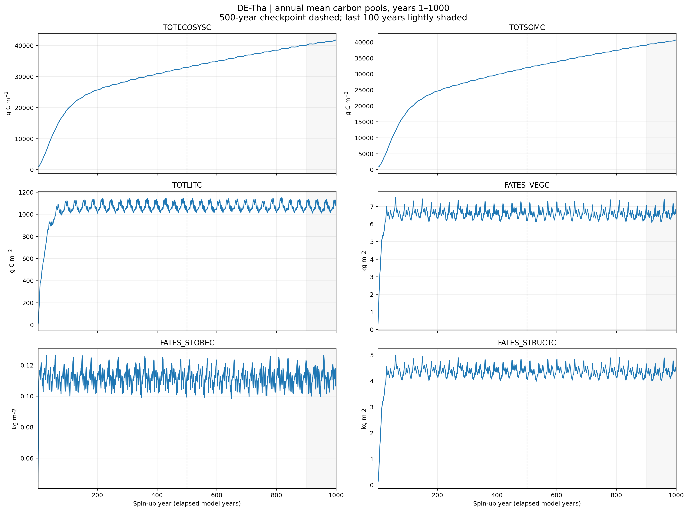

**Carbon pools, last 250 years**

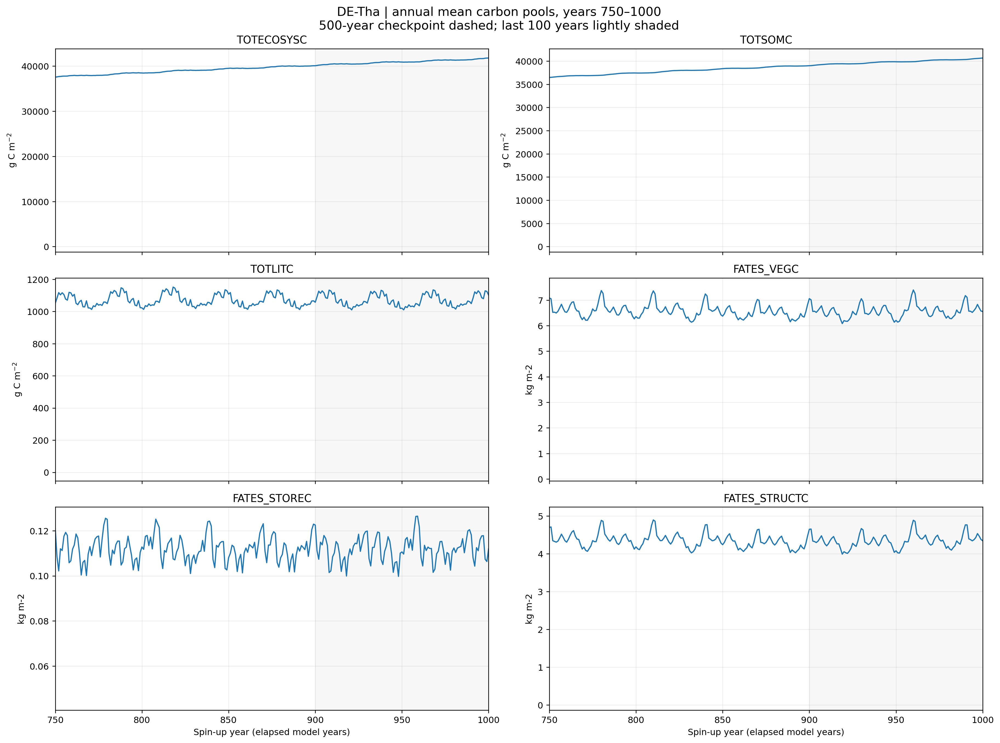

**Latest complete forcing-cycle GPP/NEE versus EC**

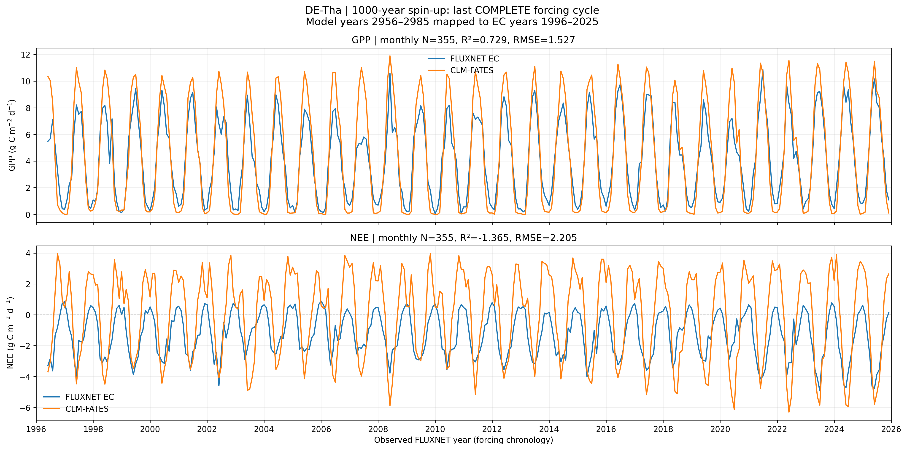

[Carbon annual means](figures/spinup1000_final/DE-Tha/DE-Tha_carbon_annual_means.csv) · [Convergence statistics](figures/spinup1000_final/DE-Tha/DE-Tha_convergence_metrics.csv) · [Monthly GPP/NEE skill statistics](figures/spinup1000_final/DE-Tha/DE-Tha_monthly_metrics.csv)

### DK-Sor — 1000 years

**Carbon pools, years 1–1000**

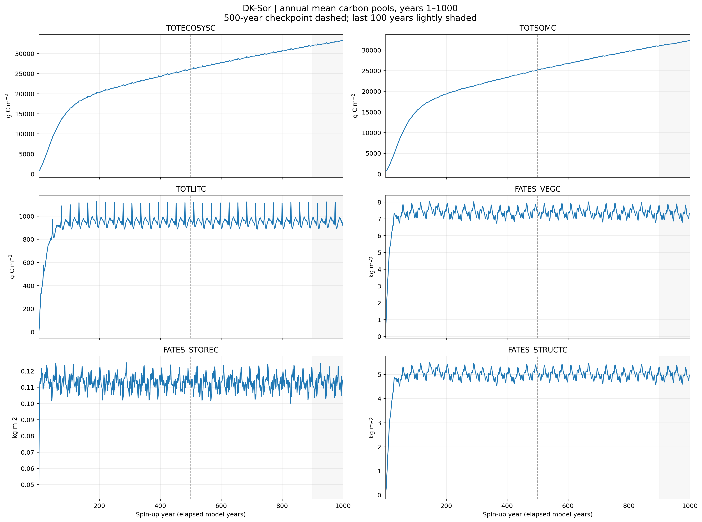

**Carbon pools, last 250 years**

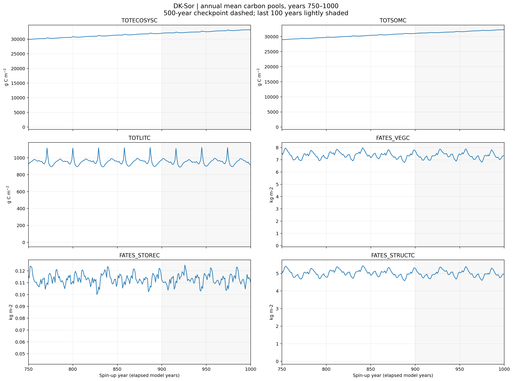

**Latest complete forcing-cycle GPP/NEE versus EC**

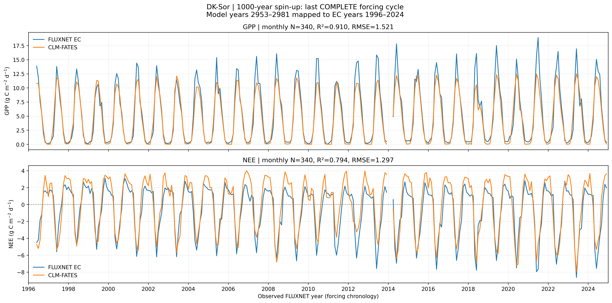

[Carbon annual means](figures/spinup1000_final/DK-Sor/DK-Sor_carbon_annual_means.csv) · [Convergence statistics](figures/spinup1000_final/DK-Sor/DK-Sor_convergence_metrics.csv) · [Monthly GPP/NEE skill statistics](figures/spinup1000_final/DK-Sor/DK-Sor_monthly_metrics.csv)

### NL-Loo — 1000 years

**Carbon pools, years 1–1000**

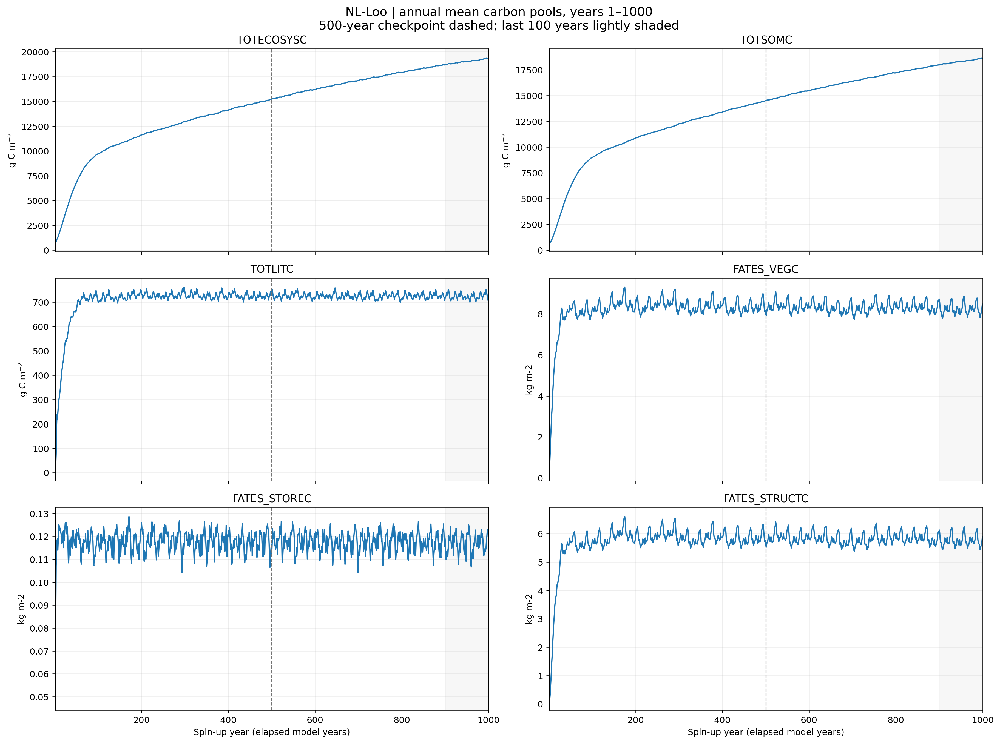

**Carbon pools, last 250 years**

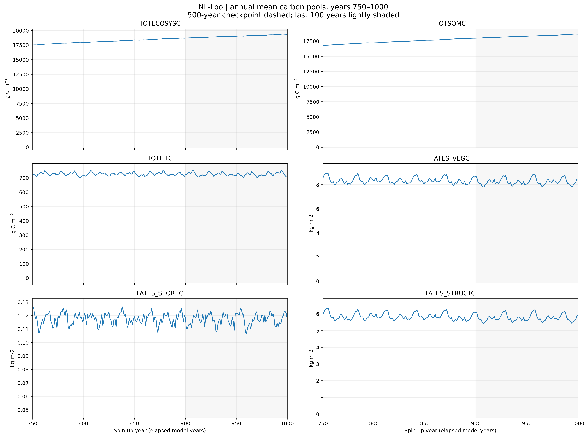

**Latest complete forcing-cycle GPP/NEE versus EC**

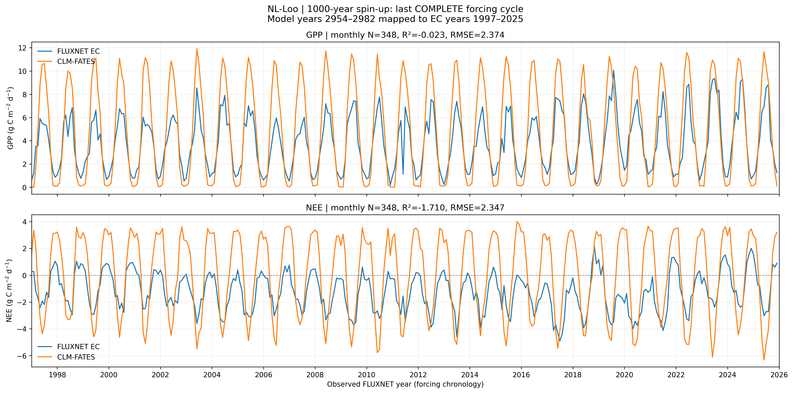

[Carbon annual means](figures/spinup1000_final/NL-Loo/NL-Loo_carbon_annual_means.csv) · [Convergence statistics](figures/spinup1000_final/NL-Loo/NL-Loo_convergence_metrics.csv) · [Monthly GPP/NEE skill statistics](figures/spinup1000_final/NL-Loo/NL-Loo_monthly_metrics.csv)

### IL-Yat — 1000 years

**Carbon pools, years 1–1000**

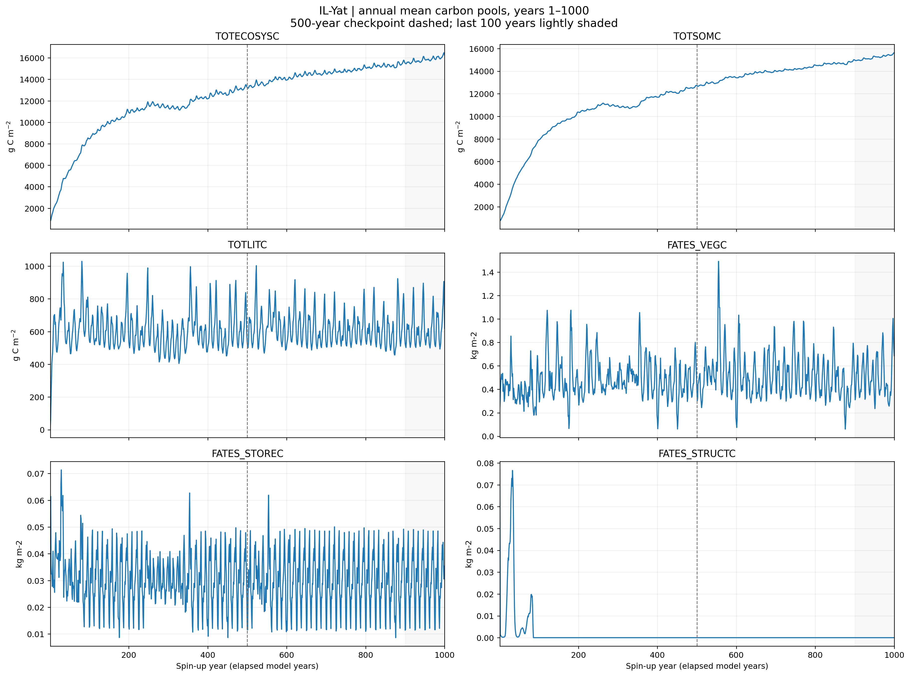

**Carbon pools, last 250 years**

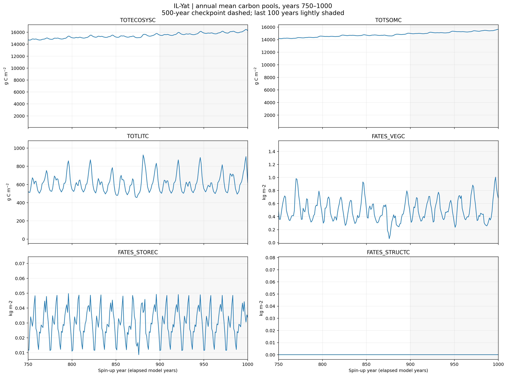

**Latest complete forcing-cycle GPP/NEE versus EC**

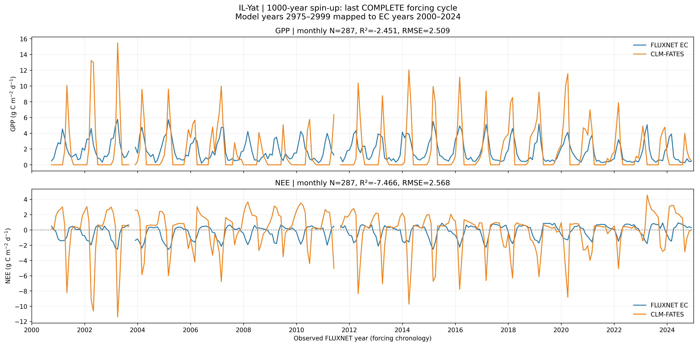

[Carbon annual means](figures/spinup1000_final/IL-Yat/IL-Yat_carbon_annual_means.csv) · [Convergence statistics](figures/spinup1000_final/IL-Yat/IL-Yat_convergence_metrics.csv) · [Monthly GPP/NEE skill statistics](figures/spinup1000_final/IL-Yat/IL-Yat_monthly_metrics.csv)

The published CSV files contain simulated carbon pools and
aggregate diagnostics. Raw EC time series, paired monthly EC/model
flux tables, original flux packages, NetCDF history and restarts,
cluster paths, and job logs are deliberately excluded.

<!-- SPINUP1000_FINAL_RESULTS_END -->

## Operational recovery incident (2026-10-18)

- [DE-Hai: CIME startup failure and five-year recovery](docs/DE_Hai_GIT_INDEX_LOCK_RECOVERY_2026-10-18.md) — incident evidence, checkpoint validation and caveats.

<!-- DK_SOR_HISTORICAL_PILOT_START -->

## Stage 10 — 1000-year restart and historical flux-evaluation pilot (2026-10-18)

**Scientific motivation.** The five-site 1000-year spin-ups still show slow soil-carbon accumulation, but the research objective is to test whether CLM-FATES reproduces *GPP and NEE dynamics*, not solely whether every slow soil pool has equilibrated. The next test separates **flux stability** from **soil/vegetation carbon-stock stability**.

**Experiment A — 500 vs 1000 years (read-only):** compare model-model GPP, NEE, respiration and LAI for *identical forcing-year phases* in complete meteorological cycles, as well as EC skill (R², RMSE, bias). Similar EC R² alone is insufficient evidence that model fluxes stopped changing. Independently report SOC/vegetation/litter carbon trends and verify total-carbon accounting in FATES.

**Experiment B — DK-Sor historical hybrid pilot:** initialize a new, isolated `DK-Sor_FATES_HIST1996_2024_TEST` case using the original spin-up's archived `2996-01-01` restart, reset the model clock to `1996-01-01`, and first test one historical year at fixed 361.93 ppm CO2. Both experiments use real EC-period meteorological years; the spin-up *cycles* 1996–2024 repeatedly whereas the proposed historical run uses that interval just once. Future controlled tests will separately introduce genuinely time-varying historical CO2.

**Status:** Hybrid case cloning, restart staging, land `finidat`, DK-Sor surface, and CIME `preview_run` were observed successful. **Pilot job has NOT been confirmed submitted or completed.** At the last reported checkpoint `BUILD_COMPLETE=FALSE` after `case.setup --reset`; build provenance and hybrid time-alignment must be checked before submitting. The original spin-up cases/restarts must be preserved. DE-Hai is excluded from the current five-site final results; IL-Yat requires structural vegetation-carbon investigation before historical benchmarking.

- **[Detailed experiment design, comparison windows, existing configuration and limitations](docs/DK_Sor_historical_hybrid_flux_stability_experiment_2026-10-18.md)**
- [DK-Sor historical hybrid preparation script (archived; **do not re-run** on the already prepared case)](scripts/17_prepare_DK_Sor_historical_pilot.sh)
- [Read-only DK-Sor case / restart / build preflight](scripts/18_audit_DK_Sor_historical_pilot.sh)
- [Five-site 1000-year figures and numerical diagnostics](figures/spinup1000_final/)

<!-- DK_SOR_HISTORICAL_PILOT_END -->

<!-- FIVE_SITE_SPINUP3000_START -->
## Five-site continuation: 1000 to 3000 model years (18 October 2026)

Sites: **RU-Fyo, DE-Tha, DK-Sor, NL-Loo, IL-Yat**; DE-Hai excluded.
The original five completed 1000 model years. A separate continuation adds 2000 years (400 x 5-year job segments, `RESUBMIT=399`), retaining each site's original case name, fixed CO2, forcing cycle and model settings. Each model job requests one CPU, 8 GiB RAM and nonexclusive Slurm allocation, with `srun --mpi=pmix --cpu-bind=cores` for CPU affinity.

- [One-click wrapper](scripts/20_five_site_spinup1000_plus2000_oneclick.sh)
- [Generated continuation code](scripts/21_five_site_spinup1000_to3000_generated.sh)
- [Continuation documentation](docs/spinup1000_to3000_continuation_2026-10-18.md)

This section documents the experiment configuration; successful 3000-year completion and carbon-pool convergence remain to be verified.
<!-- FIVE_SITE_SPINUP3000_END -->
<!-- SIX_SITE_RESEARCH_FILESTORE_START -->

## Research Filestore archive: six-site 1000-year CLM-FATES experiments (19 October 2026)

**Location (IRIDIS6 NFS):** `/research/xclimatetbm/ly3n24/CLM_FATES/Spinup_Archives/FLUXNET_MultiSite_6/`
**Windows SMB:** `\\xclimatetbm.files.soton.ac.uk\xclimatetbm`
**Status:** Archive location selected and migration workflow documented; **per-site transfer verification and Scratch cleanup are not independently confirmed**.

This six-site example is the first documented use of Southampton Research Filestore for long-term CLM-FATES NetCDF history retention. **Five stations** (RU-Fyo, DE-Tha, DK-Sor, NL-Loo, IL-Yat) previously completed 1000 model years and already have carbon-pool, convergence and monthly GPP/NEE results under [`figures/spinup1000_final/`](figures/spinup1000_final/). **DE-Hai is a backup-only exception**; it is not listed as a completed 1000-year station.

On 18 October 2026, the Scratch **file-count quota** (614,400/614,400 files; space 629/2000 GB) triggered `Disk quota exceeded` failures in ParallelIO and CIME. Research Filestore showed approximately 2.2 TB available at inspection, so completed outputs can be copied there to support future xarray-based plots. This is *not* a substitute for validating the site's active 1000→3000-year restart chain. Do not delete the original CIME cases, run directories, current recovery checkpoints, or DE-Hai original files.

- **[Detailed storage incident, scientific status, directory layout, backup instructions, safety/retention policy and plotting example](docs/research_filestore_README.md)**
- **[Read-only six-site Research Filestore audit script](scripts/22_audit_research_filestore_sixsite.py)**
- **[Existing five-site 1000-year figures and statistics](figures/spinup1000_final/)**
- **[1000→3000 continuation plan](docs/spinup1000_to3000_continuation_2026-10-18.md)**

To inspect without changing files: `python3 scripts/22_audit_research_filestore_sixsite.py` (from this example directory on IRIDIS6).

<!-- SIX_SITE_RESEARCH_FILESTORE_END -->
