# FLUXNET eight-site CLM-FATES workflow — upload, surface, QC v5 and dynamic-ZBOT DATM

<!-- IRIDIS_LIVE_20261020_LATEST_START -->
## Latest IRIDIS6 run snapshot — 20 October 2026 (8 sites)

**This operator-observed status supersedes the earlier 20 October snapshot further down this README** (which recorded 595/580/etc. years with no queued jobs). The seven-site 500→1000-year continuation has since been submitted and advanced; FR-Hes is a separate 500-year recovery target.

| Site | Archived years / target | Remaining model years | Latest coordinated checkpoint | `RESUBMIT` | Slurm snapshot | Job IDs (as reported) |
| --- | ---: | ---: | --- | ---: | --- | --- |
| CZ-BK1 | 655 / 1000 | 345 | `2659-01-01-00000` | 68 | **PENDING** | 4491684:PENDING, 4491685:PENDING |
| IT-Ren | 635 / 1000 | 365 | `2634-01-01-00000` | 72 | **PENDING** | 4489461:PENDING |
| FR-Hes | 360 / 500 | 140 | `2357-01-01-00000` | 27 | **IDLE** | — |
| FR-FBn | 650 / 1000 | 350 | `2658-01-01-00000` | 69 | **PENDING** | 4491523:PENDING, 4491524:PENDING |
| DE-Hzd | 645 / 1000 | 355 | `2655-01-01-00000` | 70 | **RUNNING** | 4490536:RUNNING, 4490537:PENDING |
| CH-Dav | 640 / 1000 | 360 | `2637-01-01-00000` | 71 | **RUNNING** | 4490534:RUNNING, 4490535:PENDING |
| BE-Vie | 645 / 1000 | 355 | `2641-01-01-00000` | 70 | **PENDING** | 4489678:PENDING |
| IT-Lav | 650 / 1000 | 350 | `2653-01-01-00000` | 69 | **PENDING** | 4490898:PENDING, 4490899:PENDING |

**Summary:** 2 RUNNING (DE-Hzd, CH-Dav), 5 PENDING, 1 IDLE (FR-Hes), 0 complete at the current targets. Across all eight cases, **4,880 of 7,500 target model-years** have verified checkpoints, **2,620 years remain**, and the seven 1000-year continuation cases are actively queued/running. FR-Hes is at **360/500**, has **no job** in this snapshot, and its earlier unarchived-success/archiving anomaly must be investigated before resubmission. No new FR-Hes submission is claimed.

Source: operator-provided, read-only IRIDIS6 `check_four_spinups.py` report on **20 October 2026**. The report shows the newest archived, minimally validated three-component CIME restart and the Slurm queue at that instant, **not the current model timestep**. This page is not live telemetry. `RUNNING`/`PENDING` do not prove the next five-year segment has completed; `COMPLETE` means a target-year restart was observed, not that all history has been rechecked or that carbon pools/FATES demography have converged. No submissions, restart edits, or Slurm actions were performed in this README update.
<!-- IRIDIS_LIVE_20261020_LATEST_END -->

## Spin-up progress snapshot — 20/10/2026 (IRIDIS6 read-only audit)

**Measured on 20/10/2026**, based on the operator-supplied output of `audit_four_batches_live.py --batch FLUXNET_MultiSite_8`. These are the cumulative **model years elapsed**, not the meteorological forcing-window length. The recorded history-file count, consecutive annual h0a coverage and most recent archived restart model year were equal for every site. **No site had a Slurm job in the queue at this snapshot.** This is a dated snapshot, **not an automatically updating live status**.

| Site | Annual h0a history | Consecutive model years | Archived restart elapsed years | Slurm queue | 1000-year milestone |
| --- | ---: | ---: | ---: | --- | --- |
| CZ-BK1 | 595 | 595 | 595 | NONE | Not reached |
| IT-Ren | 580 | 580 | 580 | NONE | Not reached |
| FR-Hes | 360 | 360 | 360 | NONE | Not reached; earlier DATM/CIME failure and recovery |
| FR-FBn | 590 | 590 | 590 | NONE | Not reached |
| DE-Hzd | 590 | 590 | 590 | NONE | Not reached |
| CH-Dav | 585 | 585 | 585 | NONE | Not reached |
| BE-Vie | 590 | 590 | 590 | NONE | Not reached |
| IT-Lav | 590 | 590 | 590 | NONE | Not reached |

**Summary: 0/8 confirmed at 1000 model years; 7/8 have exceeded 500, while FR-Hes is at 360.** `Queue=NONE` only means no jobs were visible in `squeue`; it does not diagnose why resubmission stopped. The year counts do not demonstrate ecological/carbon convergence, final scientific QC, or completion of Research Filestore archival.

- Run the [read-only four-batch progress checker](../../scripts/research_filestore/audit_four_batches_live.py) again for a newer timestamp before revising these numbers.
- Once a site has **1000 consecutive annual h0a files** and a corresponding archived 1000-year restart, and has no active jobs, use the [selective Research Filestore copy-and-SHA256 verification script](../../scripts/research_filestore/archive_completed_8_13.py) to archive that specific site. Preserve all Scratch originals and active continuation checkpoints.
- [FR-Hes restart incident and earlier recovery evidence](docs/FR_Hes_DATM_XML_FILE_NOT_FOUND_RECOVERY_2026-10-18.md).

### 20/10/2026 incomplete spin-up snapshot and Scratch retention

The eight cases are incomplete at 360–595 model years. A [copy-only Research Filestore backup script](../../scripts/research_filestore/archive_eight_site_incomplete.py) copies historical NetCDF, archived restart, run snapshot, and selected case metadata, verifies source/destination SHA-256, and **never deletes Scratch originals**. The current continuation/recovery scripts may require Scratch-side `lnd/hist` files and coordinated restart pointers. Therefore successful copy alone is **not permission to delete** annual `h0a` files. Validate the full restart components and change dependent diagnostics/recovery workflow paths before any carefully controlled history-only cleanup; retain checkpoint `rest/`, live `run/`, `rpointer.*`, DATM forcing, executable, and CIME case.

**Forcing/data snapshot (2026-10-12):** Eight site datasets transferred and extracted on IRIDIS6; point surfaces created; forcing QC v5 run with targeted human reviews; three FR-Hes temperature/humidity time steps revised in a **separate** versioned forcing file. **188/188** annual candidate DATM NetCDF files validated. Each site has `STRUCTURE_OK_REVIEW`: this certifies structural/numerical checks, **not** complete scientific forcing, PFT or spin-up readiness.

This example parallels [`../FLUXNET_MultiSite_6/`](../FLUXNET_MultiSite_6/). It deliberately contains source scripts and decision documentation **only**. Do not commit or redistribute downloaded FLUXNET/ICOS/EUF ZIPs, raw or processed CSVs, weather data, output NetCDFs, or model archives. Respect each network's data licence and citation requirements.

## Sites

| Site | Release prefix and eligible period | Model forcing years | Annual DATM |
| --- | --- | --- | ---: |
| CZ-BK1 | ICOS (2004–2026) | 2004–2025 | 22 |
| IT-Ren | ICOS (1999–2026) | 1999–2025 | 27 |
| FR-Hes | ICOS (1997–2026) | 1997–2025 | 29 |
| FR-FBn | ICOS (2008–2024) | 2008–2024 | 17 |
| DE-Hzd | ICOS (2010–2025) | 2010–2025 | 16 |
| CH-Dav | ICOS (1997–2026) | 1997–2025 | 29 |
| BE-Vie | ICOS (1996–2026) | 1996–2025 | 30 |
| IT-Lav | EUF (2003–2020) | 2003–2020 | 18 |

## File layout

```text
examples/FLUXNET_MultiSite_8/
├── README.md
├── .gitignore
├── docs/
│   └── QC_and_DATM_decisions.md
└── scripts/
    ├── 00_upload_8_fluxnet_to_iridis.sh      # run in WSL, only if re-uploading sources
    ├── 00_sync_iridis_scripts.sh              # run in WSL to copy actual working scripts from IRIDIS
    ├── 01_extract_8_fluxnet_nested.py         # run on IRIDIS after upload
    ├── 02_make_8_surfaces.sh                   # copied from ~/make_8_surfaces.sh on IRIDIS
    ├── 03_prepare_eight_site_forcing_v5.py    # copied from actual IRIDIS version
    ├── 07_make_eight_site_datm_timevarying_zbot.py
    ├── 09_FRHes_manual_v1_rebuild_eight_datm.py
    ├── 08_audit_eight_site_datm_surface.py
    └── [additional optional QC and review scripts]
```

## Workflow: where commands are run

### 00 — Workstation WSL to IRIDIS6 (source data, one-time)

Source ZIPs expected in `D:\Fluxes_Tower_Experiment\ICOS` (`/mnt/d/Fluxes_Tower_Experiment/ICOS` in WSL). The script uploads to `/iridisfs/scratch/ly3n24/CLM_FATES/sites/MY_EC_SITE/<site>/forcing/packages/` via SSH/rsync. Run **only if the source packages need uploading again**:

```bash
bash examples/FLUXNET_MultiSite_8/scripts/00_upload_8_fluxnet_to_iridis.sh
```

On IRIDIS, unpack nested archives once:

```bash
python scripts/01_extract_8_fluxnet_nested.py
```

The original package releases remain outside Git. Both scripts include eight hard-coded release names and IRIDIS directory defaults. Check them if datasets change.

### 01–03 — Surface and candidate meteorological forcing (IRIDIS6)

On IRIDIS, with `conda activate clm_fates_env` and this example available in a clone:

```bash
bash scripts/02_make_8_surfaces.sh
python scripts/03a_check_8_site_coverage.py                # when present
python scripts/03_prepare_eight_site_forcing_v5.py
python scripts/04_audit_eight_site_qc_v5.py                # when present
```

These stages have already been completed for the recorded October 2026 experiment. **Do not re-run them into existing production directories without verifying the current script and backup/versioning behaviour.** QC v5 is a candidate, provenance-preserving research screen: short interpolation, station-level ERA5_HH gap fills, RH repairs, and manual-review registers. It must not silently overwrite original FLUXMET measurements.

### 04–06 — Human revision, time-varying BIF ZBOT, and DATM (IRIDIS6)

- `07_make_eight_site_datm_timevarying_zbot.py` is the generic eight-site candidate writer, used before the FR-Hes revision.
- `09_FRHes_manual_v1_rebuild_eight_datm.py` is the **actual recorded final revision**. It produces `FR-Hes/forcing/processed_v5_manual_v1/`, preserves prior FR-Hes NetCDF files in a backup folder, creates the corresponding version-aware DATM generator and verifies 188/188 files. It expects the base script at `~/07_make_eight_site_datm_timevarying_zbot.py`, so copy these scripts back into IRIDIS home when reproducing from a Git clone.
- `08_audit_eight_site_datm_surface.py` applies the six-site NetCDF, surface, PFT and height audit standards. It records review notes; `STRUCTURE_OK_REVIEW` is normal when scientific caveats remain.

The **final FR-Hes DATM uses the `processed_v5_manual_v1` forcing**, not the original `processed_v5` CSV. Running the generic 07 writer by itself against the final FR-Hes NetCDF files will detect a source SHA mismatch: use the version-aware generator produced by 09, or explicitly configure the revised forcing source.

Example command to independently repeat read-only audit (only after NetCDFs are present):

```bash
python ~/08_audit_eight_site_datm_surface.py
```

### Scientific review summary

See [`docs/QC_and_DATM_decisions.md`](docs/QC_and_DATM_decisions.md) for each human decision, ERA provenance, FR-Hes change ledger, surface/PFT warnings, and the retained unverified high precipitation of DE-Hzd.

## Stage 07 — Independent 500-year spin-ups

The actual executed IRIDIS code is in
[`scripts/09_eight_site_spinup500.sh`](scripts/09_eight_site_spinup500.sh).
It was generated from the successful six-site configuration by
[`scripts/build_eight_spinup.py`](scripts/build_eight_spinup.py).

All eight cases passed preflight and preparation, and the IRIDIS submission
manifest records `SUBMITTED` for each initial job. Each case targets **500
model years** in 100 five-year segments, with a site-specific complete forcing
cycle, a fixed first-year CO2 concentration, `NO_LEAP`, and `ATM_NCPL=48`.

See [the actual submission settings and decisions](docs/spinup500_submission.md).
**Submitting the initial batch jobs does not establish completion or scientific
convergence. Do not rerun the submission on existing active cases.**

## Reproducibility scope

- Periods are intentionally site-specific, with 2026 excluded where incomplete/future.
- All candidate annual NetCDFs have 17,520 records and use `NO_LEAP`, half-hour forcing (`ATM_NCPL=48` when configuring a model case).
- Model case setup and initial submission are documented, but 500-year completion, carbon convergence, surface/PFT suitability and independent meteorological verification are **not certified** by this example.
- Avoid uploading logs, local paths containing tokens, original data, output CSVs or `.nc` files to GitHub. The `.gitignore` excludes the principal raw and generated file types.

## Stage 08 — Corrected IRIDIS6 MPI binding and checkpoint-safe recovery (2026-10-14)

> **Use the newer [12_resume_eight_site_srun_pmix500.sh](scripts/12_resume_eight_site_srun_pmix500.sh) for the October 14 recovery.** The earlier [10_resume_shared_node_spinup500.sh](scripts/10_resume_shared_node_spinup500.sh) is an important *historical* repair for Slurm's `--exclusive` over-allocation, but **it did not fix OpenMPI process binding**. Do not rerun either recovery script on an active/submitted case.

### Why a one-CPU request was not enough

The eight independent CLM-FATES runs originally inherited two Slurm `--exclusive` directives and unnecessarily allocated 192 cores per one-rank model. Switching to one nonexclusive CPU + 8 GiB fixed **allocation**, but the CIME-generated launch `mpirun -n 1 --bind-to core --map-by socket` could bind independent ranks to CPU 0 despite their **different Slurm allocations**. Eight runs on node `red6082` subsequently timed out after one hour while continuing to progress through model years. Failed `afterok` archive dependencies reported `DependencyNeverSatisfied`.

Real affinity tests on one node reproduced the mismatch (Slurm CPUs 63 and 16; actual `mpirun` child affinity CPU 0 in both tests). On a later node, `srun --mpi=pmix --cpu-bind=cores` correctly kept two MPI ranks on separate, Slurm-allocated CPUs 71 and 110. A real IT-Ren run with CIME `MPI_RUN_COMMAND` set to `srun --mpi=pmix --ntasks=1 --cpus-per-task=1 --cpu-bind=cores` successfully simulated **2044–2049**: run job `4232435` (2026-10-14 01:20:19–01:28:31), archive job `4232436` (success 01:29:31), with archived checkpoint `2049-01-01-00000`. This verifies a single-site run, **not** convergence or completion of the eight 500-year trajectories. See the [full incident and recovery record](docs/srun_pmix_resume_2026-10-14.md) and [repository-wide MPI guidance](../../IRIDIS6_MPI_CPU_AFFINITY.md).

### What the corrected script does

- Restricts the operation to eight existing `<SITE>_FATES_SPINUP500` cases; does **not** touch the six finished cases.
- Checks case identity, calendar, 5-year STOP/REST, constant site CO₂, per-component MPI/thread layout, executable, archived restart pointers and data, history counts, and one-CPU/8-GiB/nonexclusive Slurm directives.
- Uses the **latest fully archived three-component** `cpl/datm/clm2` restart. It never uses partial output from a timed-out segment as a checkpoint.
- Saves the previous XML, CIME status, namelists, pointer files, and unarchived history in a separate timestamped backup under `/scratch/ly3n24/CTSM_FATES_OUTPUTS/recovery_backups/`. Only partial history files are moved; the complete archive is retained.
- Sets `MPI_RUN_COMMAND=srun --mpi=pmix --ntasks=1 --cpus-per-task=1 --cpu-bind=cores` through `./xmlchange`, leaving the existing `cesm.exe` and forcing/surface settings alone.
- Calculates remaining 5-year segments from the checkpoint: `RESUBMIT = remaining_segments - 1`. Protects the `submit` phase with a one-time session marker and checksums.
- Creates `prepare.log` directories **before** piping output to `tee` (fix for the initial 2026-10-14 preparation failure). `audit` and `status` are read-only; `prepare` changes case/restart staging but **never submits**; `submit` submits each site exactly once if the preparation manifest is unchanged.

### Run on IRIDIS6 (not WSL)

These commands assume you have transferred the repository script to `~/12_resume_eight_site_srun_pmix500.sh` on IRIDIS6. Never run preparation or submission while a target job remains in `squeue`.

```bash
conda activate clm_fates_env
bash -n ~/12_resume_eight_site_srun_pmix500.sh
bash ~/12_resume_eight_site_srun_pmix500.sh audit  # must pass without modifying files

set -o pipefail
bash ~/12_resume_eight_site_srun_pmix500.sh prepare \
  2>&1 | tee ~/fates_eight_srun_prepare.log

# Inspect the actual session path and manifest before submitting.
SESSION=$(grep '^SESSION=' ~/fates_eight_srun_prepare.log | tail -1 | cut -d= -f2-)
test -f "$SESSION/PREPARED" || { echo "Preparation incomplete"; exit 1; }
cat "$SESSION/manifest.tsv"

# Submit ONLY ONCE, after all eight sites are prepared.
bash ~/12_resume_eight_site_srun_pmix500.sh submit "$SESSION"

# Read-only monitoring after the submit; status is safe for active jobs.
bash ~/12_resume_eight_site_srun_pmix500.sh status
squeue -u ly3n24 -o '%.12i %.36j %.10T %.8C %R'
```

After the verified IT-Ren test, the recorded October 14 preflight yielded:

| Site | Last archived checkpoint | Completed / 500 y | Segments remaining | RESUBMIT |
|---|---|---:|---:|---:|
| CZ-BK1 | 2044-01-01 | 40 | 92 | 91 |
| IT-Ren | 2049-01-01 | 50 | 90 | 89 |
| FR-Hes | 2032-01-01 | 35 | 93 | 92 |
| FR-FBn | 2043-01-01 | 35 | 93 | 92 |
| DE-Hzd | 2045-01-01 | 35 | 93 | 92 |
| CH-Dav | 2032-01-01 | 35 | 93 | 92 |
| BE-Vie | 2031-01-01 | 35 | 93 | 92 |
| IT-Lav | 2038-01-01 | 35 | 93 | 92 |

These values are a dated snapshot: the script recalculates checkpoint progress on every new audit. In the *first* 2026-10-14 batch preparation, the script encountered `tee: .../cases/CZ-BK1/prepare.log: No such file or directory` after staging CZ-BK1; the corrected version creates the log directory beforehand and can prepare into a **new** session after revalidating all checkpoints. Preserve previous recovery backups.

### Troubleshooting and acceptance

- `PENDING (Priority)`: Slurm has not started the job; output files may not exist.
- `TIMEOUT`: the *single* `STOP_N=5` segment exceeded its batch `--time=01:00:00`; this is **not** a cumulative 500-year walltime.
- `DependencyNeverSatisfied` on `case.st_archive`: its required `afterok` model job did not complete successfully. Do not assume the last incomplete segment is archived.
- `MaxRSS\approx1.8 GiB` with `ReqMem=8G` was observed; memory shortage was not the documented cause of the October 13 timeouts. `sacct TotalCPU` alone can misrepresent a launched MPI process; inspect the model's dates in `atm.log` and actual affinity.
- Confirm `model execution success`, `case.run success`, `st_archive success`, a valid next coordinated restart, and reasonable walltime before accepting a completed 5-year segment.

**Do not** rerun `scripts/09_eight_site_spinup500.sh`, the historical `10_...` resumption, or `prepare` against live jobs. This repository documents the code and methods; no raw tower data, NetCDF histories, checkpoint files, private cluster logs, or authentication tokens should be committed.

## Operational recovery incident (2026-10-18)

- [FR-Hes: CIME startup failure and five-year recovery](docs/FR_Hes_DATM_XML_FILE_NOT_FOUND_RECOVERY_2026-10-18.md) — incident evidence, checkpoint validation and caveats.

<!-- EIGHT_SITE_SPINUP500_RESULTS_START -->
## Stage 09 — Seven-site 500-year spin-up diagnostics (18 October 2026)

This seven-site subset uses the original SITE_FATES_SPINUP500 cases.
**FR-Hes is excluded** until its 500-year completion is verified.
Every published carbon diagnostic was made from 500 consecutive annual
h0a history files. Finishing 500 model years does NOT imply convergence.

| Site | Carbon archive | Last complete model forcing cycle | GPP monthly R² | NEE monthly R² |
|---|---|---|---:|---:|
| CZ-BK1 | 500 verified years | 2466–2487 | 0.628 | -0.561 |
| IT-Ren | 500 verified years | 2458–2484 | 0.515 | -0.684 |
| FR-FBn | 500 verified years | 2484–2500 | -0.106 | -3.276 |
| DE-Hzd | 500 verified years | 2490–2505 | 0.714 | -0.869 |
| CH-Dav | 500 verified years | 2461–2489 | -1.304 | -0.001 |
| BE-Vie | 500 verified years | 2446–2475 | 0.871 | -0.036 |
| IT-Lav | 500 verified years | 2471–2488 | 0.291 | -3.683 |

Carbon pool diagnostics reuse the
[six-site plotting reference](../FLUXNET_MultiSite_6/scripts/14_plot_five_site_spinup1000.py).
Fluxes use the last complete, phase-aligned forcing cycle mapped to
the original EC years: GPP=FATES_GPP, NEE=-FATES_NEP (EC NEE=NEE_VUT_REF).
R² is 1 - SSE/SST (negative values are possible).

Code: [plotter](scripts/18_plot_seven_site_spinup500.py),
[Slurm job](scripts/19_submit_seven_site_spinup500.sbatch),
[publishing utility](scripts/20_publish_seven_site_spinup500.py).
[Derived result summary](figures/spinup500_final/seven_site_spinup500_summary.csv).

Only model-derived figures and limited carbon/skill CSVs are committed;
downloaded flux records, raw paired tower data, model archives,
restart data and local machine paths are not redistributed.

### CZ-BK1

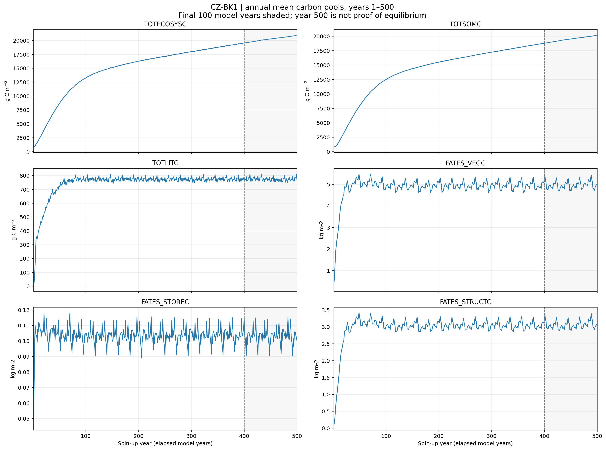

[Last 100 years](figures/spinup500_final/CZ-BK1/CZ-BK1_02_carbon_pools_last100years.png)
 · [Convergence metrics](figures/spinup500_final/CZ-BK1/CZ-BK1_convergence_metrics.csv)

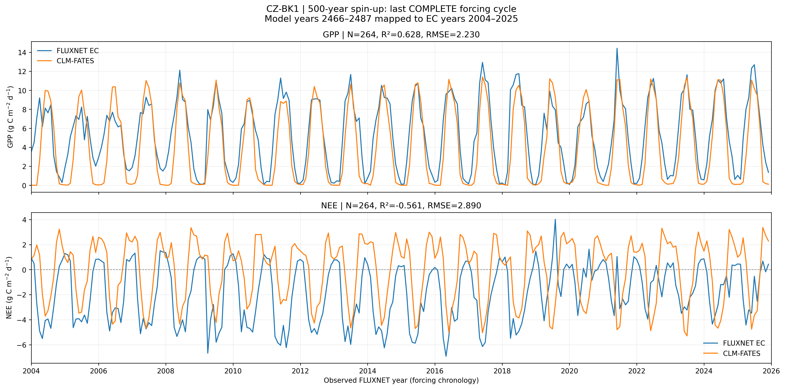

[Monthly metrics](figures/spinup500_final/CZ-BK1/CZ-BK1_monthly_metrics.csv)

### IT-Ren

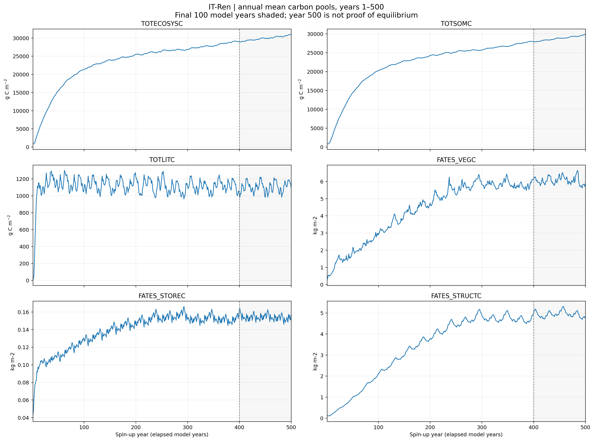

[Last 100 years](figures/spinup500_final/IT-Ren/IT-Ren_02_carbon_pools_last100years.png)
 · [Convergence metrics](figures/spinup500_final/IT-Ren/IT-Ren_convergence_metrics.csv)

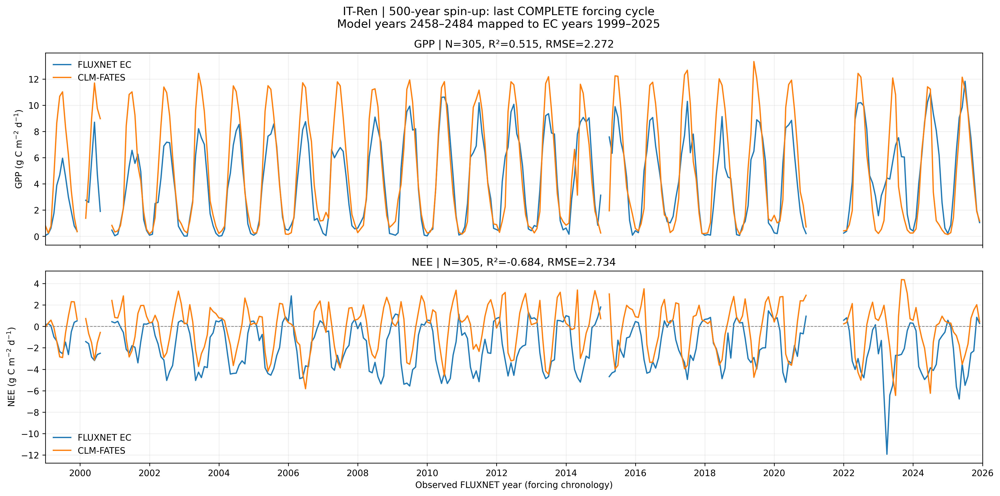

[Monthly metrics](figures/spinup500_final/IT-Ren/IT-Ren_monthly_metrics.csv)

### FR-FBn

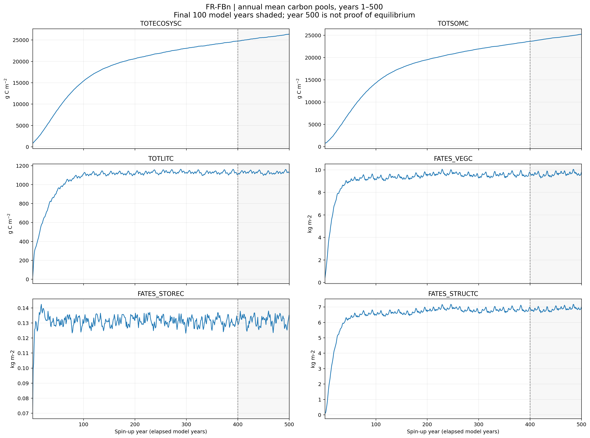

[Last 100 years](figures/spinup500_final/FR-FBn/FR-FBn_02_carbon_pools_last100years.png)
 · [Convergence metrics](figures/spinup500_final/FR-FBn/FR-FBn_convergence_metrics.csv)

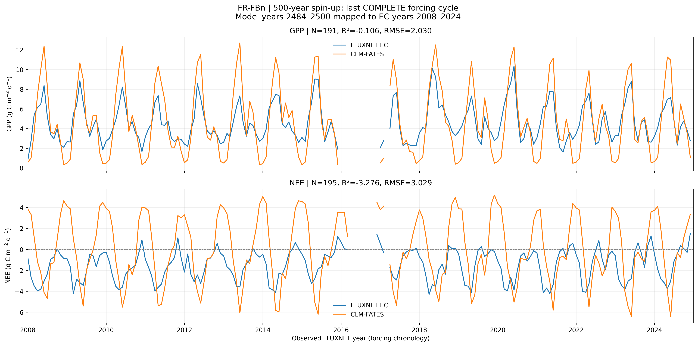

[Monthly metrics](figures/spinup500_final/FR-FBn/FR-FBn_monthly_metrics.csv)

### DE-Hzd

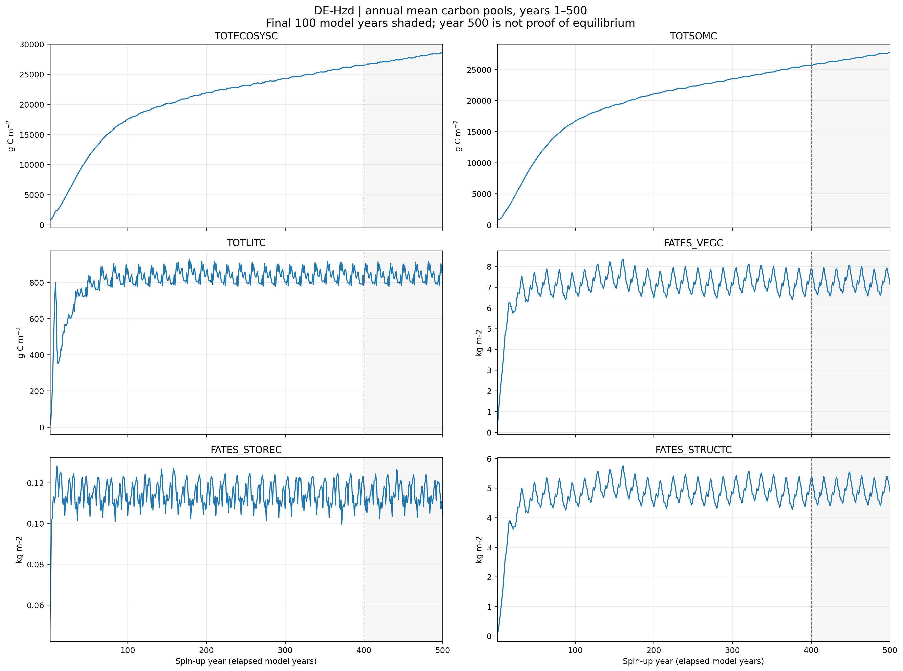

[Last 100 years](figures/spinup500_final/DE-Hzd/DE-Hzd_02_carbon_pools_last100years.png)
 · [Convergence metrics](figures/spinup500_final/DE-Hzd/DE-Hzd_convergence_metrics.csv)

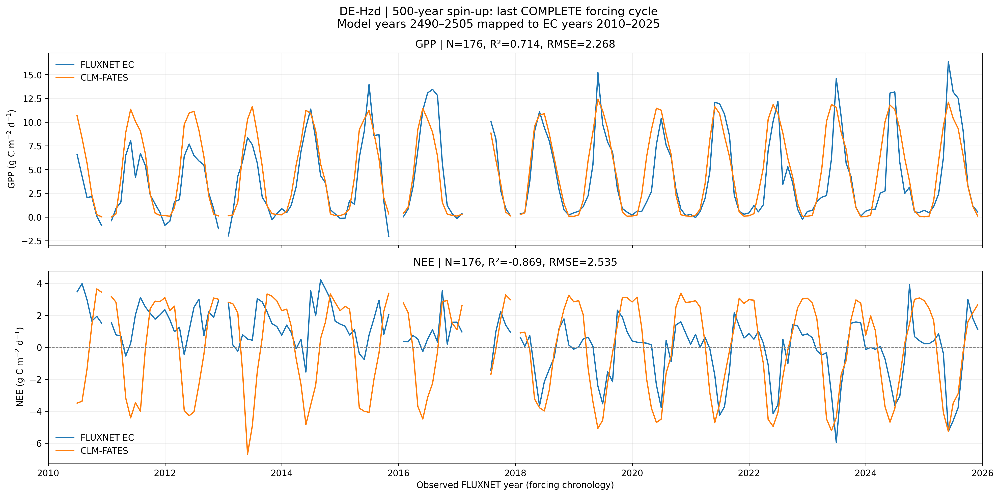

[Monthly metrics](figures/spinup500_final/DE-Hzd/DE-Hzd_monthly_metrics.csv)

### CH-Dav

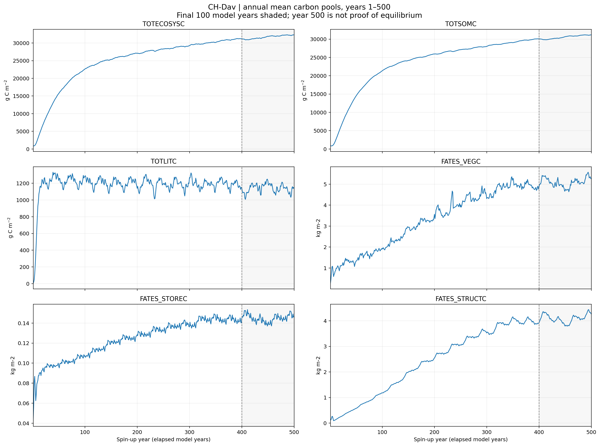

[Last 100 years](figures/spinup500_final/CH-Dav/CH-Dav_02_carbon_pools_last100years.png)
 · [Convergence metrics](figures/spinup500_final/CH-Dav/CH-Dav_convergence_metrics.csv)

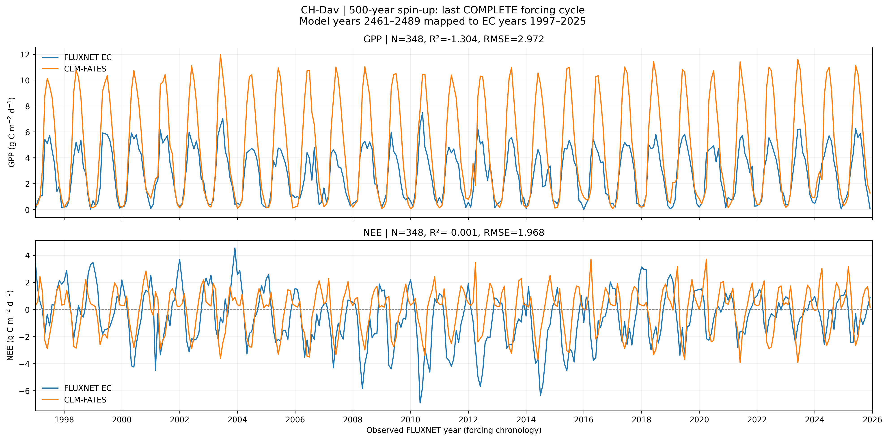

[Monthly metrics](figures/spinup500_final/CH-Dav/CH-Dav_monthly_metrics.csv)

### BE-Vie

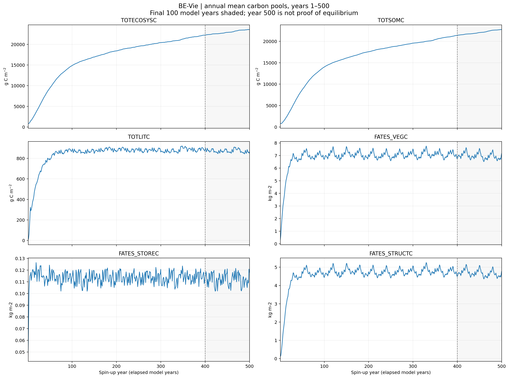

[Last 100 years](figures/spinup500_final/BE-Vie/BE-Vie_02_carbon_pools_last100years.png)
 · [Convergence metrics](figures/spinup500_final/BE-Vie/BE-Vie_convergence_metrics.csv)

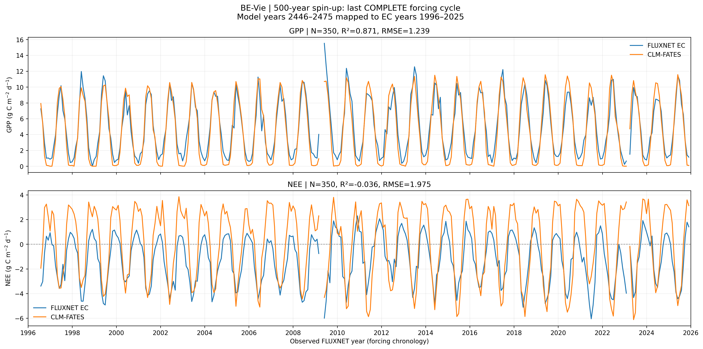

[Monthly metrics](figures/spinup500_final/BE-Vie/BE-Vie_monthly_metrics.csv)

### IT-Lav

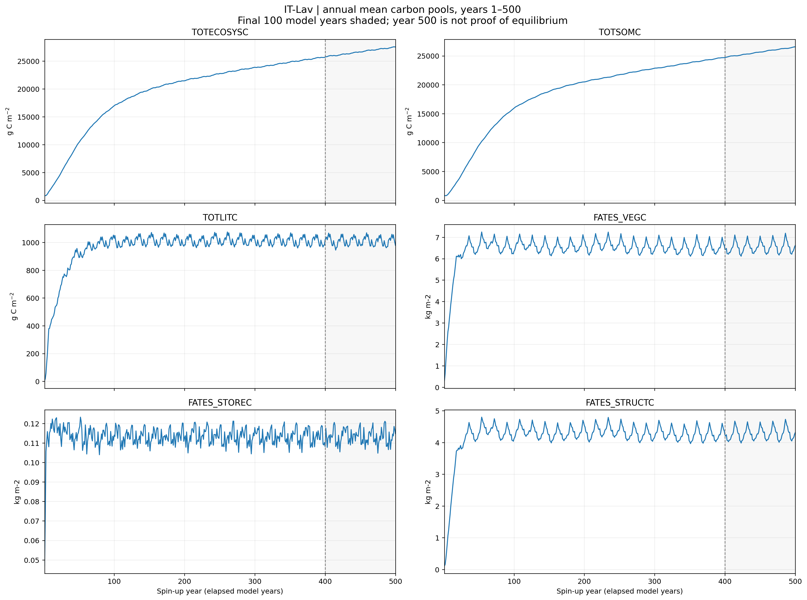

[Last 100 years](figures/spinup500_final/IT-Lav/IT-Lav_02_carbon_pools_last100years.png)
 · [Convergence metrics](figures/spinup500_final/IT-Lav/IT-Lav_convergence_metrics.csv)

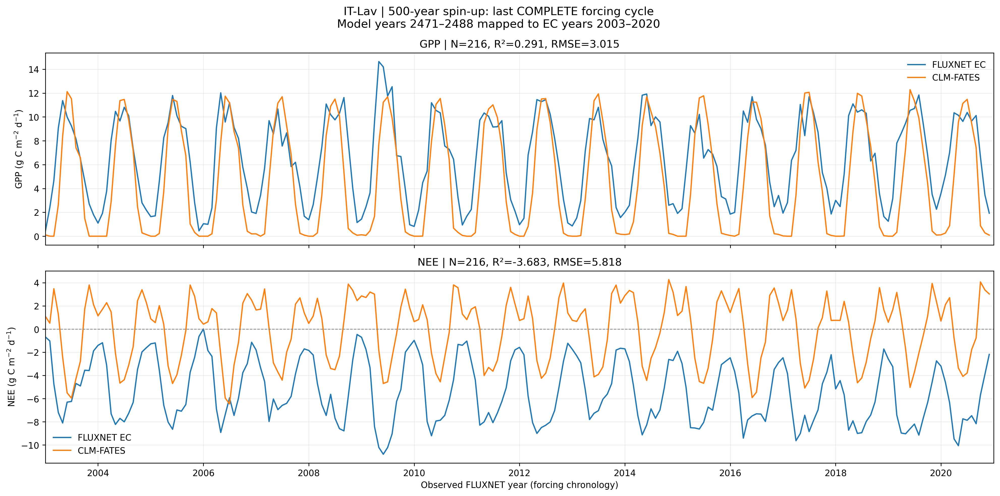

[Monthly metrics](figures/spinup500_final/IT-Lav/IT-Lav_monthly_metrics.csv)

Convergence requires separate assessment of slow carbon pools,
the aligned forcing-cycle changes, FATES demography and input QC.
<!-- EIGHT_SITE_SPINUP500_RESULTS_END -->

## Stage 09 — Seven-site 500-to-1000-year spin-up extension

**Added: 2026-10-18**

The seven selected FLUXNET_MultiSite_8 cases are intended
to continue from their fully archived 500-model-year
checkpoints to a cumulative 1000 model years.

### Target sites

| Site | Original case | Target model years |
| --- | --- | ---: |
| CZ-BK1 | CZ-BK1_FATES_SPINUP500 | 1000 |
| IT-Ren | IT-Ren_FATES_SPINUP500 | 1000 |
| FR-FBn | FR-FBn_FATES_SPINUP500 | 1000 |
| DE-Hzd | DE-Hzd_FATES_SPINUP500 | 1000 |
| CH-Dav | CH-Dav_FATES_SPINUP500 | 1000 |
| BE-Vie | BE-Vie_FATES_SPINUP500 | 1000 |
| IT-Lav | IT-Lav_FATES_SPINUP500 | 1000 |

**FR-Hes is excluded** pending confirmation of a
complete 500-year archived run.

### Implementation

Script:
[`scripts/13_extend_seven_site_spinup500_to1000.sh`](scripts/13_extend_seven_site_spinup500_to1000.sh)

The implementation is adapted from the six-site
500-to-1000-year continuation workflow, retaining
the checkpoint-safe CIME recovery procedure.

- Continue from complete archived restart files.
- Preserve existing CIME cases and model executables.
- Preserve each site's meteorological forcing cycle.
- Preserve time-varying DATM ZBOT and surface inputs.
- Preserve fixed site-specific spin-up CO2.
- Keep NO_LEAP and ATM_NCPL=48.
- Continue in five-model-year segments.
- For exactly 500 completed years, use RESUBMIT=99
  for the remaining 100 five-year segments.
- Preserve historical 500-year archives and history.
- Use one MPI rank, one CPU core and 8 GB per job.
- Remove Slurm exclusive allocation.
- Use Slurm-aware PMIx MPI launch with core binding.
- Exclude FR-Hes from this extension.

MPI launch:

```bash
srun --mpi=pmix --ntasks=1 --cpus-per-task=1 --cpu-bind=cores
```

### Execute on IRIDIS6

Production submission, only once:

```bash
bash scripts/13_extend_seven_site_spinup500_to1000.sh run
```

Read-only progress:

```bash
bash scripts/13_extend_seven_site_spinup500_to1000.sh status
```

Run from the `FLUXNET_MultiSite_8` example directory.

### Important notes

The original `_FATES_SPINUP500` case name is retained
even when the cumulative simulation reaches 1000 years.

The script requires fully archived restart components,
appropriate CaseStatus records, compatible scientific
settings and no active target-site jobs.

No preliminary test simulation or model rebuild is run.

A successful submission does not establish completion
of 1000 model years or carbon-pool convergence.
Actual completion must be established from IRIDIS6
model history, successful archives and restart records.

Do not rerun production submission against active jobs.
Do not upload FLUXNET data, NetCDF output, private
cluster logs or restart archives to GitHub.

<!-- EIGHT_SITE_QUOTA_RECOVERY_20261020 -->
## Stage 10 — Checkpoint-safe recovery after Scratch inode interruption (20 October 2026)

- [Single-site inspect/prepare/submit recovery script](scripts/21_resume_eight_site_after_quota.py)
- [IRIDIS6 operation guide](docs/resume_after_inode_quota_2026-10-20.md)

The script works on **existing** `SITE_FATES_SPINUP500` cases. For the seven sites already verified to have 500-year archives, the target is cumulative 1000 model years; for FR-Hes, the current target is cumulative 500 years. Live progress is determined from IRIDIS6 restart archives, not from dated GitHub status. It refuses submission if a site has queued/running Slurm jobs, already reached target, has newer unarchived restart files, inconsistent configuration, or incomplete checkpoint components.

`inspect` is read-only; `prepare SITE` backs up case settings and stages a verified checkpoint but **does not submit**; `submit SESSION` requires an unchanged prepared manifest and runs `case.submit` once. Never run old creation/whole-batch scripts on active or previously submitted cases. Scientific convergence and actual subsequent 5-year model/archive completion require separate checks. This addition documents the method; it does **not** claim any jobs were resumed successfully.
<!-- END EIGHT_SITE_QUOTA_RECOVERY_20261020 -->


## Scratch image and analysis archival to Research Filestore

All new Scratch-based diagnostic figures can be inventoried, SHA256-verified and copied to the shared Research Filestore using the repository-wide [cross-batch archival script](../../scripts/research_filestore/archive_scratch_analysis.py) and [step-by-step runbook](../../docs/SCRATCH_ANALYSIS_TO_RFS.md).

**Batch:** `FLUXNET_MultiSite_8`. On an **IRIDIS6 login node** (not Slurm compute node):

```bash
cd ~/CLM-FATES-single-site-workflows
python3 -B scripts/research_filestore/archive_scratch_analysis.py audit --batch FLUXNET_MultiSite_8
python3 -B scripts/research_filestore/archive_scratch_analysis.py copy --batch FLUXNET_MultiSite_8
```

Copy receipts are written to `/research/xclimatetbm/ly3n24/CLM_FATES/FLUXNET_MultiSite_8/scratch_analysis_archive/_receipts/`. Independently `verify --receipt <actual-RFS-receipt.json>` before optionally running `prune --receipt <actual-RFS-receipt.json> --confirm DELETE_VERIFIED_SCRATCH_IMAGES`. Only precisely verified **Scratch images** are removed; related analysis CSV/JSON, model history/restarts, raw forcing, CIME cases, GitHub figures and Home files are never deleted by this tool. The script skips uncertain locations, so audit actual results and use the established Home→RFS workflow where appropriate.

**Status:** Documentation and reusable code published; no Scratch→RFS copy or deletion is claimed to have run on IRIDIS6 from this GitHub update.

### Home analysis archives (supplementary)

Historical Home-based derived figures and companion statistical tables may be archived using [`archive_home_analyses.py`](../../scripts/research_filestore/archive_home_analyses.py) and its [no-clone IRIDIS6 runbook](../../docs/HOME_ANALYSIS_TO_RFS.md). Use `audit --batch FLUXNET_MultiSite_8` then `copy --batch FLUXNET_MultiSite_8` on a login node. Results go to Research Filestore under `FLUXNET_MultiSite_8/home_analysis_archive/` with SHA256 receipts; original Home files are **never deleted**. This link records available procedures, **not** confirmation that the Home transfer has executed.
